# BRD Hệ thống Khuyến nông – Module Phòng Trồng trọt v7.7 (tóm tắt có cấu trúc)

> Nguồn: “BRD Hệ thống Khuyến nông – Module Phòng Trồng trọt v7.7”, ngày 01/10/2026, BA Vũ Phương Mai (Mekong Green); khách hàng TTKNQG và TTKN tỉnh An Giang. Kèm “Design Sample · Screens” (Design_Sample_Screens.pdf).
> Tài liệu này tóm tắt **đầy đủ** mọi UR, FN (mô tả, luồng, quy tắc nghiệp vụ, tiêu chí chấp nhận), ma trận phân quyền, menu, NFR và các điểm đã chốt, để lập trình viên không cần mở bản docx. Câu chữ quy tắc và tiêu chí giữ sát nguyên văn; phần “Ghi chú phân tích” (đánh dấu **[PT]**) là của nhóm phát triển, không thuộc BRD.
> Phân tích khoảng cách: [kn-v7.7-gap.md](kn-v7.7-gap.md). Kế hoạch: [kn-v7.7-plan.md](kn-v7.7-plan.md).

**Lưu ý chung của BRD (A5, v7.2):** mọi wireframe và mục “Thiết kế hệ thống” chỉ là **màn hình mẫu**; số liệu trên hình là giả định. Giao diện, vị trí thành phần, tên nút, bộ lọc được phép thay đổi khi thiết kế chi tiết, miễn đáp ứng yêu cầu, quy tắc và tiêu chí chấp nhận.

**Tiêu chí chấp nhận chung (áp dụng cho MỌI FN, v7.4):** dữ liệu tạo mới, thay đổi từ giao diện được cập nhật vào cơ sở dữ liệu; mọi thay đổi có truy vết (log thay đổi hoặc trường người tạo, người sửa, thời điểm tạo, thời điểm sửa) để biết ai đã thay đổi gì và khi nào. Trong tài liệu này gọi tắt là **AC-CHUNG**.

---

## 0. Lịch sử phiên bản (rút gọn)

| Phiên bản | Ngày | Thay đổi chính |
|---|---|---|
| v1.0–v5.5 | 29/07–29/09/2026 | BRD App Khuyến nông dùng chung 5 tỉnh ĐBSCL (bản mà mã hiện tại dựa vào) |
| v6.0 | 30/09 | Viết lại theo buổi phân quyền 30/09: tập trung Phòng Trồng trọt, 4 vai trò, đăng nhập 2 bước, menu theo vai trò |
| v6.1–v6.4 | 01/10 | Bộ mẫu báo cáo tuần/tháng/vụ của TTKN An Giang; màn nhập giữ đúng mẫu Excel, mỗi xã một tab |
| v7.0 | 01/10 | Đổi tên “Hệ thống Khuyến nông – Module Phòng Trồng trọt”; tổ chức FN theo vai trò, đánh số lại |
| v7.1 | 01/10 | Bỏ chức năng “Thiết lập vụ, lịch kỳ” và “Kế hoạch tỉnh giao, số liệu nền” (kỳ, hạn nộp, cột Tỉnh giao khai báo khi phát hành biểu); tách 14 UR nhập báo cáo; Admin quản lý mẫu báo cáo; Báo cáo tổng hợp các xã có nút “Cập nhật” + nhật ký |
| v7.3 | 01/10 | Vẽ lại wireframe theo Design Sample (sidebar xanh đậm, nhóm menu, List/Detail/Dashboard, Noto Serif + Roboto) |
| v7.4 | 01/10 | Chốt điểm 1–21: một tài khoản nhiều vai trò, phòng ban; Admin không chọn phòng ban; Cấp Xã không có Dashboard; Báo cáo Chi cục chỉ xuất file + gửi email từ hệ thống; AC-CHUNG |
| v7.5 | 01/10 | FN-AD-04.04: màn Detail tài khoản có Log chỉnh sửa |
| v7.6 | 01/10 | Chốt 4 điểm mở cuối: Báo cáo đột xuất do Admin tạo mẫu; nhận diện theo TTKNQG; NFR sẵn sàng/sao lưu; dùng email công vụ + tài khoản Google của TTKN An Giang. **Không còn điểm mở** |
| v7.7 | 01/10 | Thêm wireframe menu sau đăng nhập của Cấp Quốc gia, Tỉnh, Xã (Hình 3d, 3e, 3f) |

**[PT]** Văn bản BRD nhắc “Mục V.3 (menu theo vai trò)” và “Mục VII (điểm đã xác nhận / còn mở)” nhưng bản v7.7 nhận được **không có** hai mục này (kết thúc ở Mục VI). Menu theo vai trò ở §6 dưới đây dựng lại từ Hình 3c–3f và đường dẫn menu của từng FN; các điểm đã chốt dựng lại từ lịch sử thay đổi v7.4–v7.6 (§9).

---

## 1. Tổng quan

### 1.1 Bối cảnh, mục tiêu
- Đề án 1 triệu ha lúa chất lượng cao, phát thải thấp (QĐ 1490/QĐ-TTg). Hệ thống Khuyến nông gồm **nhiều module theo Phòng ban chuyên môn**; tài liệu này là Module **Phòng Trồng trọt**.
- Hiện trạng An Giang: báo cáo trên Google Sheet, mỗi xã một email dùng chung; gom thủ công Cán bộ xã → chuyên viên Phòng Trồng trọt → Phòng KH-TC → lãnh đạo.
- Mục tiêu: (1) số hóa nhập số liệu gốc cấp xã **đúng bộ mẫu tuần/tháng/vụ** trên Web và Mobile; (2) Tỉnh biết ngay xã đã nộp/chưa nộp/trễ hạn và nhắc trên hệ thống; (3) tự tổng hợp toàn tỉnh theo kỳ, hỗ trợ lập báo cáo gửi Chi cục; (4) Cấp Quốc gia xem trực tiếp báo cáo, dashboard của Tỉnh và Xã; (5) phân quyền theo 4 vai trò và Phòng ban, một tài khoản nhiều vai trò/phòng ban, mỗi phiên chỉ thấy menu của vai trò + phòng ban đang dùng.

### 1.2 Phạm vi
- **Trong phạm vi:** Web App (mọi vai trò), Mobile App (ưu tiên Cán bộ xã nhập hiện trường); dữ liệu và báo cáo Phòng Trồng trọt; TTKN An Giang và các xã/phường của tỉnh; Cấp Quốc gia xem; 4 vai trò; 25 chức năng (Mục IV); xuất Excel/PDF.
- **Ngoài phạm vi module:**

| Nội dung | Thuộc |
|---|---|
| Báo cáo Chăn nuôi, Nuôi trồng & Đánh bắt Thủy sản | Module Phòng Chăn nuôi - Thủy sản |
| Tổng hợp báo cáo liên phòng; Dự án khuyến nông | Module Phòng Kế hoạch - Tài chính |
| Thư viện kỹ thuật & tin tức; Quản trị đào tạo; Giá cả thị trường | Module dùng chung / Phòng Thông tin - Truyền thông |
| Hồ sơ cán bộ khuyến nông; Điều tra, khảo sát chuyên đề; Bản đồ GIS vùng trồng & dịch bệnh | Module dùng chung |
| Liên thông dữ liệu App HTX (HTX, thửa ruộng vẫn lưu theo bộ mã định danh để liên thông) | Tích hợp hệ thống ngoài |
| MRV và tín chỉ carbon; tài chính - kế toán; học trực tuyến; hệ thống của Chi cục | Hệ thống ngoài |

### 1.3 Vai trò người dùng

| Vai trò | Mô tả / nhu cầu |
|---|---|
| **Cấp Quốc gia (TW)** | Cán bộ TTKNQG. Chỉ xem dashboard và báo cáo tuần/tháng/vụ/năm của Tỉnh và Xã; không thêm, sửa, xóa |
| **Cấp Tỉnh** | Cán bộ TTKN tỉnh An Giang – Phòng Trồng trọt. Phát hành biểu cho xã (kèm kỳ, hạn, Tỉnh giao); theo dõi, nhắc, rà soát, chốt kỳ; xem báo cáo các xã; lập báo cáo gửi Chi cục; duyệt lịch công tác Cán bộ xã |
| **Cấp Xã** | Cán bộ xã phụ trách Trồng trọt (gồm “cán bộ tăng cường”), phân công **một hoặc nhiều** xã/phường. Nhập số liệu gốc theo mẫu cho các xã phụ trách; quản lý HTX, máy móc, thửa ruộng, vật tư; đăng ký lịch làm việc hằng tuần |
| **Admin** | Quản trị viên hệ thống (Mekong Green). Không chọn phòng ban; menu gom dữ liệu theo từng phòng ban + nhóm Quản trị hệ thống. Quản lý ĐVHC, cơ cấu tổ chức, phòng ban, tài khoản, danh mục, mẫu báo cáo; vào được menu mọi cấp để hỗ trợ |

### 1.4 Vấn đề → kết quả mong muốn
| Hiện tại | Mong muốn |
|---|---|
| Google Sheet dùng chung qua email xã; không biết ai nhập, dễ ghi đè | Tài khoản riêng, chỉ thấy dòng của xã mình; có lịch sử gửi và sửa |
| Không biết ngay xã chưa nộp; nhắc qua điện thoại, Zalo | Trạng thái nộp thời gian thực; nhắc ngay trên hệ thống |
| Gộp thủ công Excel/Word; công thức Sheet lỗi (#REF!, lệch cột) | Tự tổng hợp đúng mẫu; công thức cố định theo mẫu |
| TTKNQG chờ tỉnh gửi | Cấp Quốc gia xem trực tiếp |

### 1.5 Thuật ngữ
| Thuật ngữ | Định nghĩa |
|---|---|
| TTKNQG / Cấp Quốc gia (TW) | Trung tâm Khuyến nông Quốc gia; vai trò cấp Trung ương |
| TTKN tỉnh / Cấp Tỉnh | TTKN tỉnh An Giang; vai trò cấp tỉnh |
| Cấp Xã | Cán bộ khuyến nông phụ trách một hoặc nhiều xã/phường |
| **Phòng ban** | Đơn vị chuyên môn trực thuộc TTKN; **mỗi Phòng ban là một module**, khai báo trong danh mục Phòng ban |
| **Nút** | Một đơn vị trên Cây tổ chức 3 cấp (TTKNQG – TTKN tỉnh – Xã/phường), xác định phạm vi dữ liệu của tài khoản |
| **Khu vực** | Nhóm xã/phường theo địa bàn huyện cũ, để sắp xếp và cộng tổng trong báo cáo; **thuộc tính của Nút xã** |
| **Mẫu báo cáo** | Cấu trúc bảng (cột, dòng, tiêu đề gộp, công thức) của một báo cáo, do Admin quản lý và gán cho loại báo cáo của phòng ban. 14 mẫu Phòng Trồng trọt (T01–T07 tuần, M01 tháng, V01–V06 vụ) khởi tạo từ bộ Excel hiện hành |
| **Kỳ báo cáo / Chốt kỳ** | Tuần, tháng, vụ, năm. Chốt kỳ = thời điểm khóa số liệu của kỳ; sau chốt không sửa trực tiếp |
| **Công việc** | Một lần phải nộp của **một xã** cho **một biểu** trong **một kỳ**; sinh ra khi Cấp Tỉnh phát hành biểu |
| Chi cục | Cơ quan cấp tỉnh nhận báo cáo trồng trọt từ TTKN tỉnh; nhận file qua email gửi từ hệ thống |
| ĐVHC / HTX | Đơn vị hành chính / Hợp tác xã nông nghiệp |

### 1.6 Tài liệu liên quan
1. Bảng trắng phân quyền & chức năng 30/09/2026 (artifact claude.ai).
2. Google Sheet “Báo cáo cây lúa, rau màu hằng tuần” – nguồn T01–T07.
3. Google Sheet “Báo cáo cây ăn trái hằng tháng” – nguồn M01.
4. Google Sheet “Báo cáo áp dụng TBKT, CGH, CCG hằng vụ” – nguồn V01–V06.
5. Design Sample · Screens (Sidebar, Footer, Login, Chọn phòng ban, Dashboard, List, Detail).

**[PT]** Các Google Sheet 2–4 **không có** trong đầu vào nhận được — xem §8.3 và kn-v7.7-plan.md §4.

### 1.7 Ràng buộc, giả định
- Tiếng Việt; ĐVHC theo sắp xếp 2025; ATTT cấp độ 3; dữ liệu cá nhân theo NĐ 13/2023/NĐ-CP.
- Màn nhập liệu giữ đúng bộ mẫu Excel hiện hành của TTKN An Giang; danh mục giống lúa, vật tư, cây trồng, sâu bệnh, ĐVHC theo danh mục chuẩn.
- A1: danh sách cán bộ, HTX, nông hộ có sẵn dạng Excel để nạp ban đầu. A2: mỗi cán bộ có tài khoản riêng; Cán bộ xã có điện thoại GPS, camera. A3: TTKN An Giang cung cấp email nhận của Chi cục, **email công vụ và tài khoản Google** dùng để gửi. A4: TTKN An Giang ban hành quy định vận hành (hạn nộp, chốt kỳ, phân công địa bàn) trước triển khai. A5: wireframe là mẫu.

---

## 2. Quy trình nghiệp vụ

**As-Is:** điểm nghẽn (1) email dùng chung, ghi đè; (2) không biết xã chưa nộp; (3) gộp thủ công nhiều bước, công thức lỗi; TTKNQG chờ tỉnh. Kỳ: tuần, tháng, vụ, năm.

**To-Be** (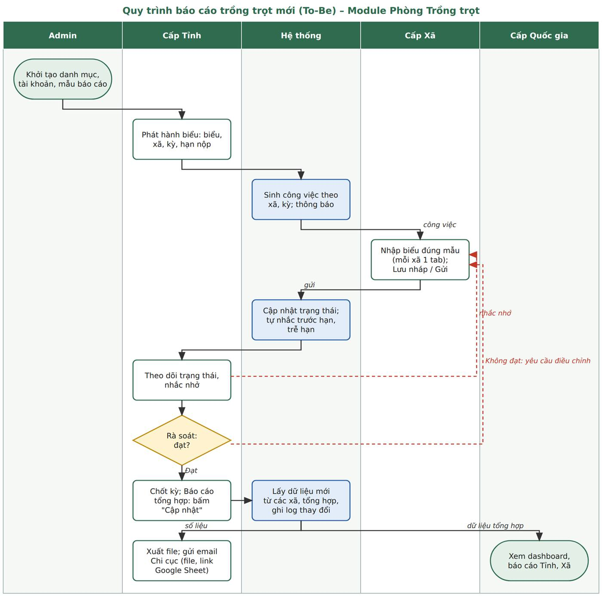):

| Bước | Vai trò | Nội dung | FN |
|---|---|---|---|
| 1 | Admin | Khởi tạo ĐVHC, cơ cấu tổ chức, phòng ban, tài khoản, danh mục; tạo và gán mẫu báo cáo cho Phòng Trồng trọt | FN-AD-04.01 → 04.06 |
| 2 | Cấp Tỉnh | Phát hành biểu: chọn biểu, xã, kỳ, hạn nộp, giá trị cột Tỉnh giao; hệ thống sinh công việc và thông báo | FN-TI-02.02 |
| 3 | Cấp Xã | Xem công việc; nhập đúng mẫu cho từng xã phụ trách (mỗi xã một tab); lưu nháp, gửi | FN-XA-03.01, 03.02 |
| 4 | Cấp Tỉnh | Theo dõi trạng thái nộp, nhắc; rà soát, yêu cầu điều chỉnh; chốt kỳ | FN-TI-02.03, 02.04 |
| 5 | Cấp Tỉnh, Hệ thống | Mở Báo cáo Xã, bấm “Cập nhật”: lấy dữ liệu mới nhất, tổng hợp đúng mẫu, ghi nhật ký | FN-TI-02.05 |
| 6 | Cấp Tỉnh | Xuất file, gửi email cho Chi cục từ hệ thống (Excel/PDF hoặc link Google Sheet) | FN-TI-02.06 |
| 7 | Cấp Quốc gia | Xem dashboard và báo cáo của Tỉnh và Xã | FN-TW-01.01, 01.02 |

---

## 3. Danh sách yêu cầu người dùng (UR)

| Mã | Yêu cầu | FN | Ưu tiên |
|---|---|---|---|
| UR-CH-01 | Đăng nhập bằng email hoặc SĐT; tài khoản nhiều vai trò/phòng ban thì chọn vai trò và phòng ban (Admin không chọn phòng ban) | FN-CH-00.01 | Cao |
| UR-TW-01 | Cấp Quốc gia xem dashboard trồng trọt của Tỉnh và Xã | FN-TW-01.01 | Cao |
| UR-TW-02 | Cấp Quốc gia xem báo cáo tuần/tháng/vụ/năm của Tỉnh và Xã, chỉ xem | FN-TW-01.02 | Cao |
| UR-TI-01 | Cấp Tỉnh xem dashboard toàn tỉnh và tình hình nộp | FN-TI-02.01 | Cao |
| UR-TI-02 | Cấp Tỉnh phát hành biểu cho các xã, khai báo kỳ, hạn nộp, giá trị cột Tỉnh giao | FN-TI-02.02 | Cao |
| UR-TI-03 | Cấp Tỉnh biết xã chưa nộp, trễ hạn và nhắc trên hệ thống | FN-TI-02.03 | Cao |
| UR-TI-04 | Cấp Tỉnh rà soát, yêu cầu điều chỉnh kèm lý do, chốt kỳ và **mở lại kỳ** | FN-TI-02.04 | Cao |
| UR-TI-05 | Cấp Tỉnh xem tổng hợp các xã đúng mẫu, bấm “Cập nhật”, xem nhật ký thay đổi | FN-TI-02.05 | Cao |
| UR-TI-06 | Cấp Tỉnh xuất file và gửi email cho Chi cục từ hệ thống (file hoặc link Google Sheet) | FN-TI-02.06 | Cao |
| UR-TI-07 | Cấp Tỉnh xem, duyệt lịch làm việc hằng tuần Cán bộ xã và đăng ký lịch của mình | FN-TI-02.07 | Cao |
| UR-XA-01 | Cán bộ xã biết phải nộp biểu nào, cho xã nào, kỳ nào, hạn khi nào | FN-XA-03.01 | Cao |
| UR-XA-02 | Nhập **T01** – Tiến độ xuống giống lúa (PL 01) hằng tuần | FN-XA-03.02 | Cao |
| UR-XA-03 | Nhập **T02** – Xuống giống và phân trà lúa mùa (PL 01B) hằng tuần (xã có lúa mùa) | FN-XA-03.02 | TB |
| UR-XA-04 | Nhập **T03** – Phân trà lúa (PL 02) hằng tuần | FN-XA-03.02 | Cao |
| UR-XA-05 | Nhập **T04** – Xuống giống và thu hoạch rau màu (PL 03) hằng tuần | FN-XA-03.02 | Cao |
| UR-XA-06 | Nhập **T05** – Sâu bệnh hại lúa (PL 04) hằng tuần | FN-XA-03.02 | Cao |
| UR-XA-07 | Nhập **T06** – Sâu bệnh hại cây trồng khác (PL 05) hằng tuần | FN-XA-03.02 | Cao |
| UR-XA-08 | Nhập **T07** – Tiến độ thu hoạch lúa (PL 07) hằng tuần trong giai đoạn thu hoạch | FN-XA-03.02 | Cao |
| UR-XA-09 | Nhập **M01** – Cây ăn trái và cây công nghiệp (sheet tháng) hằng tháng, **trước ngày 10** | FN-XA-03.02 | Cao |
| UR-XA-10 | Nhập **V01** – Áp dụng 3 giảm 3 tăng (PL1 3G3T) hằng vụ | FN-XA-03.02 | TB |
| UR-XA-11 | Nhập **V02** – Áp dụng 1 phải 5 giảm (PL2 1P5G) hằng vụ | FN-XA-03.02 | TB |
| UR-XA-12 | Nhập **V03** – Trang thiết bị phục vụ sản xuất (cơ giới hóa) (PL3 CGH) hằng vụ | FN-XA-03.02 | TB |
| UR-XA-13 | Nhập **V04** – Cơ cấu giống lúa (PL4 CCG) hằng vụ | FN-XA-03.02 | Cao |
| UR-XA-14 | Nhập **V05** – Lượng giống gieo sạ (PL5) hằng vụ | FN-XA-03.02 | TB |
| UR-XA-15 | Nhập **V06** – Diện tích tham gia mô hình (PL6) hằng vụ | FN-XA-03.02 | TB |
| UR-XA-16 | Cập nhật danh sách HTX và nông hộ | FN-XA-03.03 | Cao |
| UR-XA-17 | Khai báo máy móc của HTX | FN-XA-03.04 | Cao |
| UR-XA-18 | Vẽ ranh giới thửa ruộng trên bản đồ, kể cả offline | FN-XA-03.05 | Cao |
| UR-XA-19 | Ghi nhận thông tin vật tư trên địa bàn | FN-XA-03.06 | TB |
| UR-XA-20 | Xem lại báo cáo đã gửi và thống kê của xã | FN-XA-03.07 | TB |
| UR-XA-21 | Đăng ký lịch làm việc hằng tuần, gửi Cấp Tỉnh duyệt | FN-XA-03.08 | Cao |
| UR-AD-01 | Admin quản lý danh mục ĐVHC | FN-AD-04.01 | Cao |
| UR-AD-02 | Admin quản lý cơ cấu tổ chức 3 cấp, gán Khu vực cho xã | FN-AD-04.02 | Cao |
| UR-AD-03 | Admin khai báo danh mục phòng ban và trạng thái áp dụng | FN-AD-04.03 | Cao |
| UR-AD-04 | Admin tạo tài khoản, phân quyền; một tài khoản nhiều vai trò và phòng ban, **mỗi vai trò có Nút, phòng ban, xã phụ trách riêng**; chỉ thực hiện sau UR-AD-02, 03 | FN-AD-04.04 | Cao |
| UR-AD-05 | Admin quản lý danh mục nông nghiệp (giống lúa, vật tư, cây trồng, sâu bệnh, loại máy, mô hình) | FN-AD-04.05 | Cao |
| UR-AD-06 | Admin chỉnh sửa mẫu báo cáo của các phòng ban cấp tỉnh, cấp xã (thêm, bớt cột, dòng), tạo mẫu mới, gán vào loại báo cáo của phòng ban | FN-AD-04.06 | Cao |
| UR-AD-07 | Admin vào menu mọi cấp, nhập liệu thay khi hỗ trợ; mọi thao tác ghi nhật ký | FN-AD-04.07 | TB |
| UR-KT-01 | Mobile chạy trên Android giá rẻ, 3G; nhập liệu và vẽ thửa được khi offline | FN-XA-03.02, 03.05 | Cao |
| UR-KT-02 | Mở thêm Phòng ban (module) bằng cấu hình danh mục và mẫu báo cáo, không phát triển lại đăng nhập và phân quyền | FN-CH-00.01, FN-AD-04.03, 04.06 | Cao |

---

## 4. Chi tiết chức năng (FN)

### 4.0 Khung giao diện chung (Design Sample)
1. **Sidebar** nền xanh đậm bên trái: logo + tên sản phẩm; nhóm menu **Điều hành / Báo cáo / Dữ liệu** (Admin: **Điều hành / Phòng ban / Quản trị hệ thống**); mục có menu con mở/đóng bằng mũi tên; mục con đang chọn nền xanh nhạt + vạch trái xanh; mục cha tự mở khi con active; chỉ một mục active; **số đếm chỉ dùng cho việc cần xử lý** (ẩn khi bằng 0); **footer “Tên sản phẩm · © đơn vị” ở cuối sidebar** (không còn footer dưới nội dung); sidebar thu gọn chỉ hiện icon, rê chuột mở flyout trắng chứa menu con.
2. **Thanh trên cùng:** breadcrumb, chuông thông báo có số đếm, menu tài khoản (họ tên, “vai trò · phòng ban”; mục “Đổi vai trò / phòng ban”, “Đổi mật khẩu”, “Đăng xuất”).
3. **Vùng nội dung:** tiêu đề trang + nút thao tác bên phải (nút chính màu xanh); thanh bộ lọc dạng thẻ có “Đặt lại”; rồi một trong ba mẫu:
   - **List:** bảng có STT, nhãn trạng thái, biểu tượng xem/sửa/xóa, phân trang số trang (“Hiển thị a–b trên n”, ‹ 1 2 3 … ›).
   - **Detail:** liên kết quay lại, tiêu đề, thanh nút, các khối Nhãn – Giá trị, tab liên quan, **khung Log bên phải** (dòng thời gian: sự kiện, người, thời điểm).
   - **Dashboard:** “Chỉ số nóng” (thẻ số + % so kỳ trước + sparkline), “Chỉ số so sánh” (thanh tiến độ theo khu vực; so sánh kỳ này/kỳ trước), “Cảnh báo” (Khẩn / Cần chú ý / Thông tin, nút Xem, “Xem tất cả”).
4. **Typography:** tiêu đề h1–h3, tên màn, tên khối, tên thẻ dùng **Noto Serif**; toàn bộ chữ còn lại (nội dung, label, nút, bảng, số liệu, badge, menu) dùng **Roboto**. **[PT]** Bản PDF Design Sample nhúng font Inter (thân) và serif thay thế; BRD ghi Roboto → lấy Roboto theo BRD.
5. Tên sản phẩm, logo, ảnh nền đăng nhập, nội dung footer **theo nhận diện của TTKNQG**; “Khuyến nông số” và ảnh nền trên wireframe là tạm.

### 4.1 FN-CH-00.01 — Đăng nhập, chọn vai trò & phòng ban
- **Mô tả:** Đăng nhập Web và Mobile bằng **email hoặc SĐT + mật khẩu**. Tài khoản có ≥ 2 vai trò hoặc ≥ 2 phòng ban → màn **“Chọn vai trò và phòng ban”**. Admin không chọn phòng ban, vào **“Tổng quan hệ thống”**. Trang mặc định: Dashboard (Quốc gia, Tỉnh), **Công việc cần làm (Xã)**, Tổng quan hệ thống (Admin).
- **Người dùng:** cả 4 vai trò. **Tiên quyết:** tài khoản do Admin tạo, trạng thái “Hoạt động”.
- **Luồng chính:** B1 nhập Email/SĐT, Mật khẩu (nút “Hiện”), “Ghi nhớ đăng nhập” → Đăng nhập. B2 xác thực; **lần đầu bắt buộc đổi mật khẩu**. B3 chỉ 1 vai trò + 1 phòng ban đang áp dụng → vào thẳng; nhiều → chọn vai trò, rồi bấm thẻ phòng ban của vai trò đó (phòng ban chưa mở hiện mờ, nhãn “Chưa mở”); Admin bỏ qua chọn phòng ban. B4 tạo **phiên gắn Vai trò + Phòng ban** (Admin: toàn hệ thống), hiện menu tương ứng.
- **Luồng phụ:** đổi vai trò/phòng ban trong menu tài khoản **không cần đăng nhập lại**. **Mobile: đăng nhập nhanh bằng PIN 6 số; đăng nhập offline với phiên đã có, tối đa 72 giờ.** “Quên mật khẩu?” và “Liên hệ quản trị viên” dẫn tới Admin. Sai thông tin → banner lỗi đỏ dưới nút, **ghi số lần thử còn lại**; **sai 5 lần → khóa tạm 15 phút**. Không có vai trò/phòng ban đang áp dụng hoặc bị khóa → thông báo liên hệ Admin.
- **Quy tắc:** không đăng ký công khai. Vai trò, phòng ban đọc từ phân quyền tài khoản (FN-AD-04.04) và danh mục phòng ban (FN-AD-04.03). **Phiên hết hạn sau 24 giờ trên Mobile, 4 giờ không thao tác trên Web.** Menu và dữ liệu chỉ theo Vai trò + Phòng ban của phiên. Menu Admin: nhóm “Phòng ban” chứa từng phòng ban, mỗi phòng ban gom menu dữ liệu (theo dõi nộp, báo cáo tổng hợp, dữ liệu báo cáo các xã, thu thập dữ liệu, danh mục, mẫu báo cáo); phòng ban chưa mở hiện mờ; nhóm “Quản trị hệ thống”: ĐVHC, cơ cấu tổ chức, phòng ban, người dùng, menu các cấp.
- **Tiêu chí chấp nhận:** đăng nhập vào đúng menu và phạm vi dữ liệu của vai trò + phòng ban đã chọn; đổi vai trò trong phiên hiện đúng menu mới; Admin vào thẳng Tổng quan hệ thống; **phòng ban chuyển “Đang áp dụng” hiện ngay mà không cần cập nhật ứng dụng**; AC-CHUNG.
- **Thiết kế:** Login: nền ảnh cánh đồng, trái logo/tên hệ thống/tiêu đề/mô tả/bản quyền, phải thẻ trắng “Đăng nhập” (banner lỗi “Sai tài khoản hoặc mật khẩu · Còn n lần thử” chỉ hiện khi thất bại). Chọn vai trò & phòng ban: hàng thẻ vai trò (vai trò, đơn vị, xã phụ trách), thẻ chọn nền trắng viền xanh; lưới thẻ phòng ban (“Vào hệ thống →”), bấm thẻ là vào luôn. Tổng quan hệ thống Admin: thẻ chỉ số (tài khoản hoạt động/đang khóa, phòng ban đang áp dụng n/6, mẫu báo cáo + bản nháp, báo cáo đã nộp), thẻ từng phòng ban (đang áp dụng: số tài khoản, mẫu, đợt phát hành đang mở, xã chưa nộp, “Mở menu phòng ban →”; chưa mở: mờ), “Cảnh báo hệ thống” (vd. tài khoản Cấp Xã chưa gán xã; xã chưa có cán bộ; mẫu ở bản nháp).

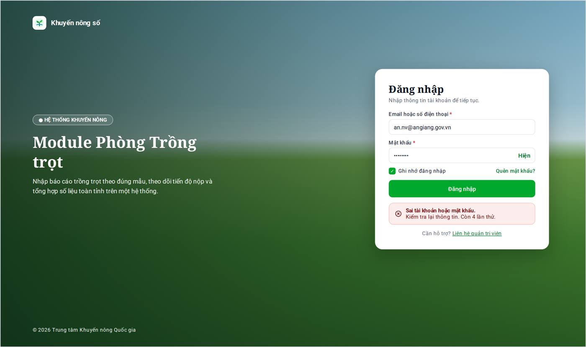
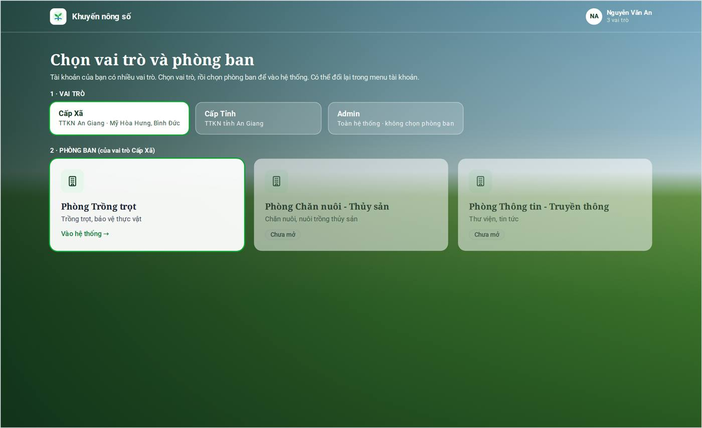
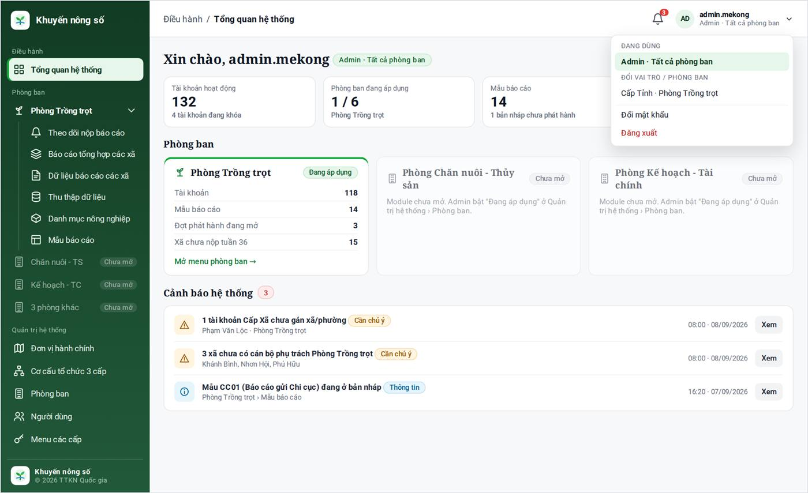
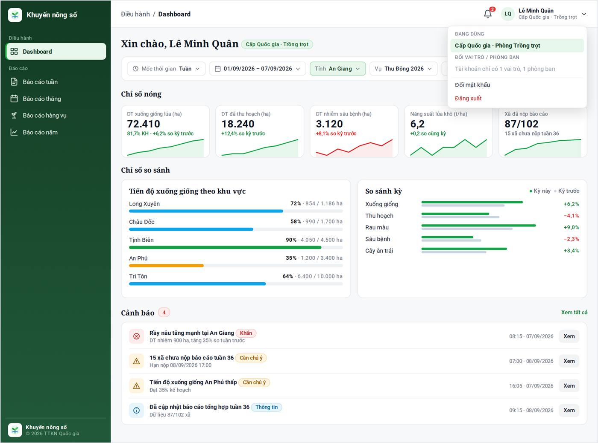
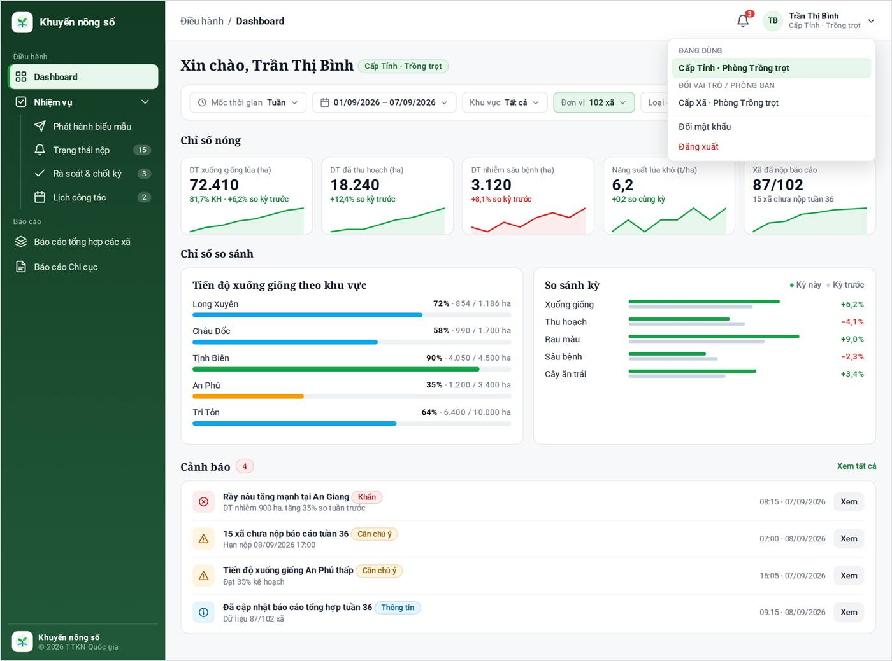
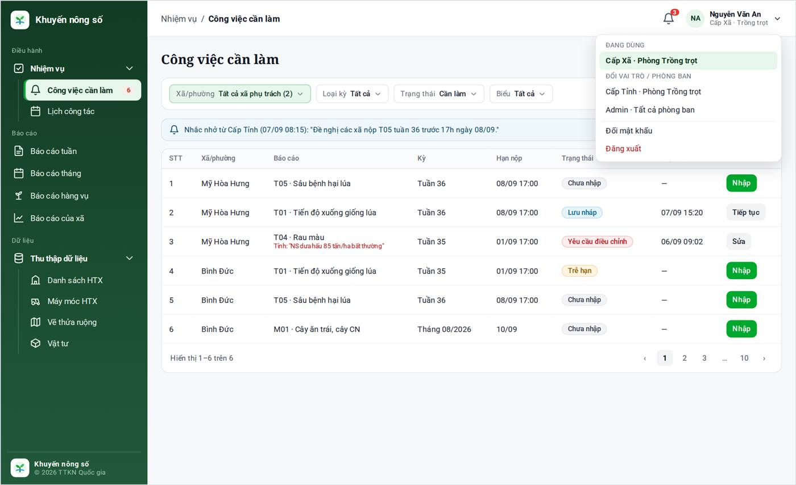

### 4.2 Cấp Quốc gia — chỉ xem, không có nút Thêm/Sửa/Xóa trên mọi màn hình

#### FN-TW-01.01 — Dashboard trồng trọt
- **Mô tả:** chỉ số trồng trọt của tỉnh được chọn: tiến độ xuống giống so kế hoạch, phân trà lúa, thu hoạch (diện tích, năng suất, sản lượng), sâu bệnh, tình hình nộp của các xã. **Menu:** Dashboard (trang mặc định). **Tiên quyết:** có báo cáo đã gửi.
- **Luồng:** B1 mở, hệ thống xác định phạm vi theo Nút + Phòng ban; B2 chọn tỉnh, vụ, kỳ; B3 xem thẻ, biểu đồ, bấm thẻ/cột/dòng để drill-down tới xã. **Phụ:** Làm mới thủ công; xuất Excel; chưa có dữ liệu → “Chưa có dữ liệu”.
- **Quy tắc:** chỉ đọc; mỗi thẻ ghi mốc cập nhật gần nhất; cấp trên = tổng cấp dưới; chỉ tính báo cáo đã gửi. **[PT]** Dữ liệu = lần cập nhật gần nhất của FN-TI-02.05 (BRD nêu rõ ở FN-TI-02.01, FN-TW-01.02, FN-TI-02.05).
- **AC:** tải < 5 giây với 500 người dùng đồng thời; AC-CHUNG.
- **Thiết kế:** bộ lọc Tỉnh, Vụ, Kỳ, mốc cập nhật; 4–5 thẻ: DT xuống giống / KH, DT đã thu hoạch kèm năng suất, DT nhiễm sâu bệnh tuần (trong đó nặng), số xã đã nộp; biểu đồ cột tiến độ xuống giống theo tuần, thanh phân trà; sâu bệnh tăng mạnh nhất, danh sách xã chưa nộp; nút Làm mới, Xuất Excel. (Hình 3d/4)

#### FN-TW-01.02 — Xem báo cáo tổng hợp của Tỉnh và Xã
- **Mô tả:** xem báo cáo tuần/tháng/vụ/năm của tỉnh theo từng biểu, **giữ đúng bố cục mẫu Excel**, đủ các xã gom theo Khu vực, có dòng tổng Khu vực và Toàn tỉnh. **Menu:** Báo cáo › Báo cáo tuần / tháng / hàng vụ / năm. **Tiên quyết:** có báo cáo đã gửi (dữ liệu lần cập nhật gần nhất ở FN-TI-02.05).
- **Luồng:** chọn loại, tỉnh, vụ, kỳ → chọn biểu (tab) → xem bảng; bấm tên xã xem báo cáo xã → Xuất Excel/PDF. **Phụ:** so sánh cùng kỳ năm trước; kỳ chưa chốt → nhãn “Tạm tính”, liệt kê xã chưa nộp.
- **Quy tắc:** chỉ xem; chỉ tính báo cáo đã gửi; toàn tỉnh = tổng các xã; **năng suất dòng tổng = bình quân gia quyền (sản lượng / DT thu hoạch)**.
- **AC:** toàn tỉnh = tổng các xã đã gửi trong kỳ; không có nút sửa; AC-CHUNG.
- **Thiết kế:** bộ lọc Tỉnh, Vụ, Kỳ, nhãn Đã chốt/Tạm tính, So sánh; tab theo biểu; bảng dựng từ mẫu (hàng chữ cái cột, tiêu đề gộp, mỗi dòng một xã, dòng tổng Khu vực/Toàn tỉnh tô xanh); thông báo “Chỉ xem”; Xuất Excel (đúng mẫu), Xuất PDF.

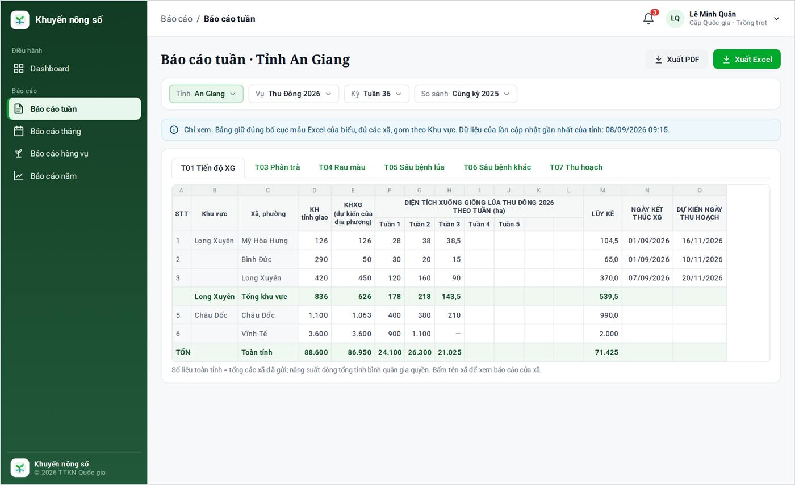

**[PT]** “Báo cáo năm” xuất hiện trong menu Cấp Quốc gia (Hình 3d) nhưng không có mẫu năm trong 14 mẫu → cần làm rõ (câu hỏi Q-07 trong kế hoạch).

### 4.3 Cấp Tỉnh

#### FN-TI-02.01 — Dashboard trồng trọt toàn tỉnh
- Như FN-TW-01.01 (dữ liệu lần cập nhật gần nhất ở FN-TI-02.05), phạm vi toàn tỉnh An Giang, **lọc thêm theo Khu vực**; khung “Xã chưa nộp” có nút **“Nhắc nhở”** (mở FN-TI-02.03). Menu: Dashboard.
- Quy tắc: chỉ đọc; chỉ thấy dữ liệu Phòng Trồng trọt của tỉnh mình. AC: **số liệu trùng báo cáo tổng hợp FN-TI-02.05 cùng kỳ**; AC-CHUNG.
- Thiết kế (Hình 3e): bộ lọc Mốc thời gian (Tuần), khoảng ngày, Khu vực, Đơn vị (n xã), Loại cây; Chỉ số nóng (DT xuống giống lúa % KH, DT đã thu hoạch, DT nhiễm sâu bệnh, năng suất lúa khô t/ha, xã đã nộp n/102); Chỉ số so sánh (tiến độ xuống giống theo khu vực; so sánh kỳ: xuống giống, thu hoạch, rau màu, sâu bệnh, cây ăn trái); Cảnh báo (sâu bệnh tăng mạnh – Khẩn; xã chưa nộp; tiến độ khu vực thấp; đã cập nhật tổng hợp – Thông tin).

#### FN-TI-02.02 — Phát hành biểu mẫu báo cáo
- **Mô tả:** chọn một hoặc nhiều mẫu **cùng loại kỳ**, chọn xã nhận, khai báo khoảng thời gian, loại kỳ, hạn nộp; nhập giá trị cột “Tỉnh giao” (vd KH tỉnh giao) nếu có. Hệ thống **sinh công việc cho từng xã theo từng kỳ** và thông báo Cán bộ xã. **Menu:** Điều hành › Nhiệm vụ › Phát hành biểu mẫu. **Tiên quyết:** mẫu đã được Admin gán cho Phòng Trồng trọt (FN-AD-04.06).
- **Luồng:** B1 chọn biểu (vd gói tuần T01, T03, T04, T05, T06). B2 phạm vi xã: Toàn tỉnh / Theo Khu vực / Chọn từng xã. B3 loại kỳ, từ ngày – đến ngày, tên vụ/đợt, **hạn nộp mỗi kỳ** (vd “Thứ Ba tuần sau, 17:00”), **số ngày chốt kỳ sau hạn**, ghi chú giao việc; **hệ thống tự chia các kỳ**. B4 nếu biểu có cột loại “Tỉnh giao”: nhập giá trị từng xã (trực tiếp, nhập Excel, hoặc lấy từ đợt trước). B5 Xem trước → “Phát hành”.
- **Luồng phụ:** xem trước biểu; xem các đợt đã phát hành; **thu hồi đợt chưa có xã nào nộp**. Xã chưa có cán bộ phụ trách → cảnh báo. Mẫu chưa có cấu trúc cột → chặn. **Sửa hạn nộp của kỳ đã phát hành → chỉ áp dụng cho kỳ chưa đến hạn.**
- **Quy tắc:** chỉ phát hành mẫu thuộc Phòng ban mình; công việc chỉ giao Cán bộ xã phụ trách xã nhận **và cùng Phòng ban**. **Tiêu đề cột theo kỳ của biểu (vd Tuần 1, Tuần 2 của PL 01) đặt theo các kỳ đã chia.** Giá trị cột “Tỉnh giao” Cấp Xã chỉ xem.
- **AC:** Cán bộ xã nhận công việc và thông báo ngay sau phát hành; Cán bộ xã khác Phòng ban không nhận; AC-CHUNG.
- **Thiết kế:** Bước 1 bảng chọn (mã, tên, loại kỳ, phiên bản mẫu v1); Bước 2 nút phạm vi + cảnh báo “102 xã/phường · 3 xã chưa có cán bộ phụ trách”; Bước 3 kỳ và hạn nộp; Bước 4 bảng xã × cột Tỉnh giao (vd “T01 · cột D ‘KH tỉnh giao’ (ha)”), Nhập Excel, Lấy từ đợt trước; khung Xem trước (số biểu, số xã, số kỳ, **số công việc sẽ tạo** = biểu × xã × kỳ, vd 5 × 102 × 17 = 8.670); nút “Đợt đã phát hành (n)”, “Xem trước biểu”, “Phát hành”.

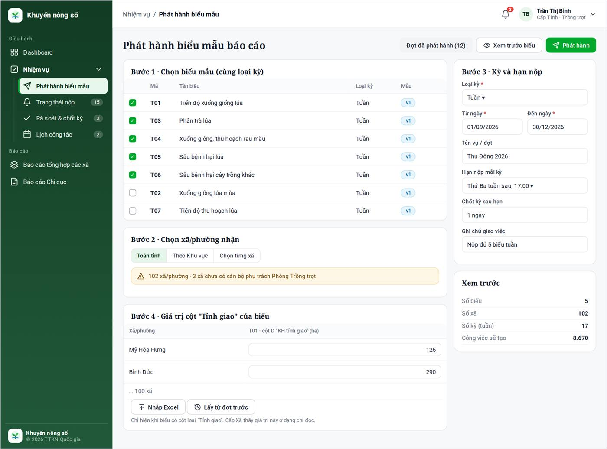

#### FN-TI-02.03 — Theo dõi trạng thái nộp và nhắc nhở
- **Mô tả:** theo dõi tình trạng nộp từng xã theo đợt, biểu, kỳ; nhắc xã chưa nộp hoặc trễ hạn. **Menu:** Điều hành › Nhiệm vụ › Trạng thái nộp (có số đếm). **Tiên quyết:** có đợt phát hành.
- **Luồng:** chọn đợt, biểu, kỳ → xem số xã **Đã nộp / Lưu nháp / Chưa nhập / Trễ hạn** và bảng theo xã → chọn xã → “Gửi nhắc nhở” kèm nội dung; nhắc hiện ở “Công việc cần làm” của Cán bộ xã → bấm xã đã nộp mở báo cáo (FN-TI-02.04).
- **Phụ:** **tự động nhắc trước hạn và khi trễ hạn theo cấu hình**; xuất Excel; xem lịch sử nhắc. Xã chưa có cán bộ → “Chưa có cán bộ”, không gửi được nhắc.
- **Quy tắc:** chỉ thấy đợt của Phòng ban mình; trạng thái cập nhật thời gian thực.
- **AC:** số xã theo trạng thái đúng thời gian thực; **Cán bộ xã nhận nhắc trong vòng 1 phút**; AC-CHUNG.
- **Thiết kế:** bộ lọc Đợt, Biểu, Kỳ, Trạng thái; 4 thẻ đếm; bảng có ô chọn: Khu vực, Xã, Cán bộ phụ trách, Trạng thái, Thời điểm gửi, Nhắc gần nhất; nút “Gửi nhắc nhở xã đã chọn”, “Nhắc tất cả xã chưa nộp”, “Xuất Excel”.

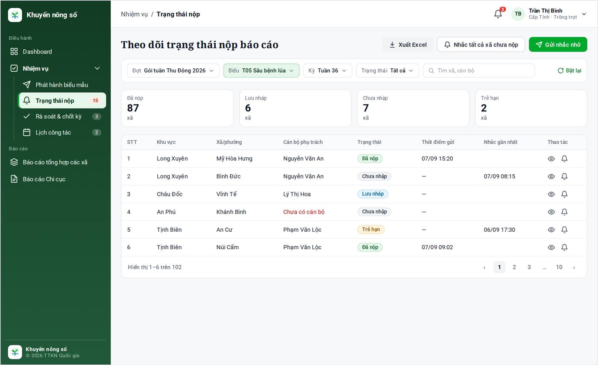

#### FN-TI-02.04 — Rà soát báo cáo, yêu cầu điều chỉnh, chốt kỳ
- **Mô tả:** xem báo cáo xã đã gửi (đúng mẫu, chỉ xem), thấy cảnh báo bất thường, yêu cầu xã điều chỉnh kèm lý do; **chốt kỳ thủ công và mở lại kỳ đã chốt cho một xã/biểu**. **Menu:** Điều hành › Nhiệm vụ › Rà soát & chốt kỳ (có số đếm).
- **Luồng:** B1 lọc biểu, kỳ, có cảnh báo; B2 chọn báo cáo → xem dòng của xã đúng mẫu; B3 “Yêu cầu điều chỉnh” (**bắt buộc lý do**) hoặc “Xác nhận”; B4 khi đủ, “Chốt kỳ ngay” hoặc để **hệ thống chốt tự động theo lịch** (hạn + số ngày chốt sau hạn); B5 mở lại kỳ đã chốt: chọn kỳ, xã/biểu, lý do, **thời hạn mở**.
- **Phụ:** yêu cầu điều chỉnh sau chốt kỳ → phải mở lại kỳ trước. Báo cáo Chi cục đã gửi của kỳ được mở lại → cảnh báo “số liệu đã thay đổi”.
- **Quy tắc:** **Cấp Tỉnh không sửa số liệu gốc của xã.** Trạng thái công việc bổ sung “Yêu cầu điều chỉnh”, “Đã xác nhận”. Sau mở lại và xã gửi lại, hệ thống tổng hợp lại và **lưu phiên bản điều chỉnh**. Mọi thao tác lưu vết. “Xác nhận” là tùy chọn; chỉ bắt buộc “Yêu cầu điều chỉnh” khi không đạt.
- **AC:** Cán bộ xã nhận yêu cầu điều chỉnh kèm lý do; số liệu sau chốt không sửa được nếu chưa mở lại; AC-CHUNG.
- **Thiết kế:** List báo cáo cần rà soát → Detail “Xã · Biểu · Kỳ”: thanh nút (Yêu cầu điều chỉnh – nút chính, Xác nhận, Mở lại kỳ, Xem báo cáo trước / Báo cáo tiếp theo); khối Thông tin báo cáo (xã, biểu, kỳ, cán bộ gửi, gửi lúc, trạng thái); khối Số liệu (đúng mẫu, chỉ xem); khối Kết quả kiểm tra (vd “Đạt yêu cầu của mẫu. Không có cảnh báo.”); ô Lý do yêu cầu điều chỉnh*; cột phải khung **Chốt kỳ** (kỳ, chốt tự động lúc, đã nộp n/102, “Chốt kỳ ngay”) và **Log** (Gửi báo cáo, Lưu nháp, Nhắc nhở, Phát hành công việc).

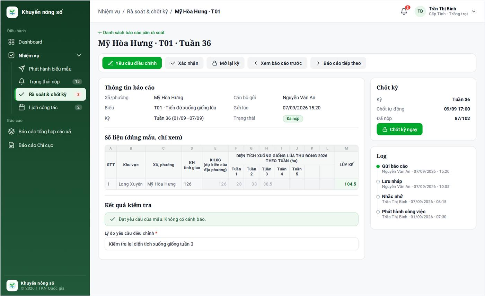

#### FN-TI-02.05 — Báo cáo tổng hợp các xã (Báo cáo Xã)
- **Mô tả:** tổng hợp báo cáo các xã theo biểu và kỳ, **đúng bố cục mẫu Excel**, đủ các xã, dòng tổng Khu vực và Toàn tỉnh. Cấp Tỉnh bấm **“Cập nhật”** để lấy dữ liệu mới nhất các xã đã gửi và tổng hợp lại; **mỗi lần cập nhật ghi nhật ký** kèm chi tiết thay đổi. **Menu:** Báo cáo › Báo cáo tổng hợp các xã.
- **Luồng:** B1 chọn loại kỳ, vụ, kỳ, Khu vực → hiện dữ liệu của **lần cập nhật gần nhất** (thời điểm, người, số xã có dữ liệu). B2 có báo cáo mới/sửa sau lần đó → thông báo “Có n thay đổi mới từ m xã”. B3 “Cập nhật” → lấy báo cáo đã gửi mới nhất từng xã, tổng hợp lại dòng tổng, **đánh dấu ô thay đổi**, ghi một dòng nhật ký. B4 chọn tab biểu; **rê chuột ô thay đổi xem giá trị cũ, người sửa, thời điểm**. B5 xem Nhật ký cập nhật và chi tiết từng lần. B6 Xuất Excel theo mẫu hoặc PDF.
- **Phụ:** tab “Thay đổi chờ cập nhật”; **hệ thống tự cập nhật một lần tại thời điểm chốt kỳ** (nhật ký “Hệ thống”); không có thay đổi → “Dữ liệu đã mới nhất”; xã chưa nộp → ô “chưa nộp”, nhãn “Tạm tính”; bấm tên xã → FN-TI-02.04; xuất nhật ký Excel.
- **Quy tắc:** chỉ lấy báo cáo “Đã gửi” (nháp không tính). Khu vực, Toàn tỉnh = tổng các xã, **không nhập tay đè**; năng suất dòng tổng = sản lượng / DT thu hoạch. Cấp Tỉnh không sửa số xã tại đây (dùng “Yêu cầu điều chỉnh”). **Nhật ký lưu:** thời điểm, người bấm (hoặc Hệ thống), số xã có dữ liệu, số xã và số ô thay đổi; chi tiết mỗi thay đổi: xã, biểu, cột Excel, giá trị cũ → mới, người sửa, thời điểm xã gửi, **loại thay đổi (Gửi mới / Gửi lại / Điều chỉnh theo yêu cầu / Tự tính)**. **Nhật ký không xóa.** Dashboard (02.01), Chi cục (02.06) và báo cáo Cấp Quốc gia dùng dữ liệu lần cập nhật gần nhất. **Không tự cập nhật định kỳ**; chỉ khi bấm và một lần tự động lúc chốt kỳ.
- **AC:** sau “Cập nhật” bảng đúng số liệu mới nhất; mọi ô thay đổi được đánh dấu và có trong nhật ký; toàn tỉnh = tổng xã; Excel xuất đúng bố cục mẫu; AC-CHUNG.

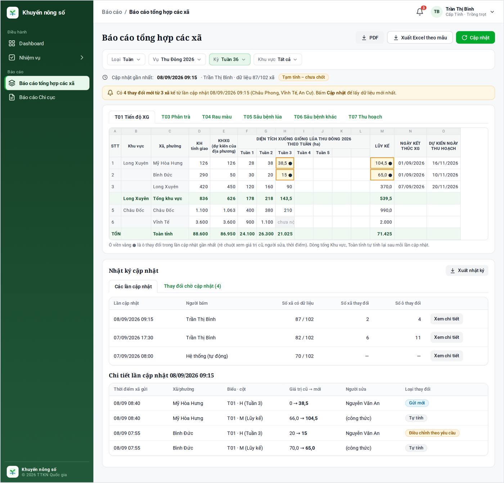

#### FN-TI-02.06 — Xuất file và gửi báo cáo Chi cục
- **Mô tả:** xuất file toàn tỉnh theo kỳ (**Excel theo mẫu, PDF và/hoặc Google Sheet**) từ lần cập nhật gần nhất của 02.05, rồi **gửi email cho Chi cục ngay từ hệ thống** (đính kèm và/hoặc link Google Sheet). **Không có bước trình duyệt.** **Menu:** Báo cáo › Báo cáo Chi cục.
- **Tiên quyết:** có dữ liệu tổng hợp của kỳ; đã khai báo email Chi cục (danh bạ người nhận); **email công vụ và tài khoản Google của TTKN An Giang đã kết nối** (email để gửi, Google để tạo link Google Sheet).
- **Luồng:** B1 chọn loại kỳ, kỳ, phạm vi. B2 chọn biểu và định dạng (Excel theo mẫu, PDF, Tạo link Google Sheet) → “Xuất file” → danh sách file. B3 nhập/chọn email Chi cục (người nhận, CC); tiêu đề, nội dung tự điền theo mẫu, sửa được. B4 “Gửi email” → gửi kèm file và/hoặc link, ghi log.
- **Phụ:** chỉ tải file, không gửi; lịch sử gửi; gửi lại. Kỳ chưa chốt → file ghi “Tạm tính”; còn xã chưa nộp → in kèm danh sách xã chưa nộp. **File vượt giới hạn đính kèm → chỉ gửi link Google Sheet.** Gửi lỗi → “Gửi lỗi”, cho gửi lại.
- **Quy tắc:** không sửa số trong file xuất; email Chi cục lưu làm mặc định; **link Google Sheet chia sẻ quyền xem cho người nhận**; log gửi: thời điểm, người gửi, người nhận, CC, kỳ, danh sách file/link, trạng thái.
- **AC:** số trong file = số tổng hợp của kỳ; Chi cục nhận email kèm file hoặc link mở được; mọi lần gửi có trong log; AC-CHUNG.

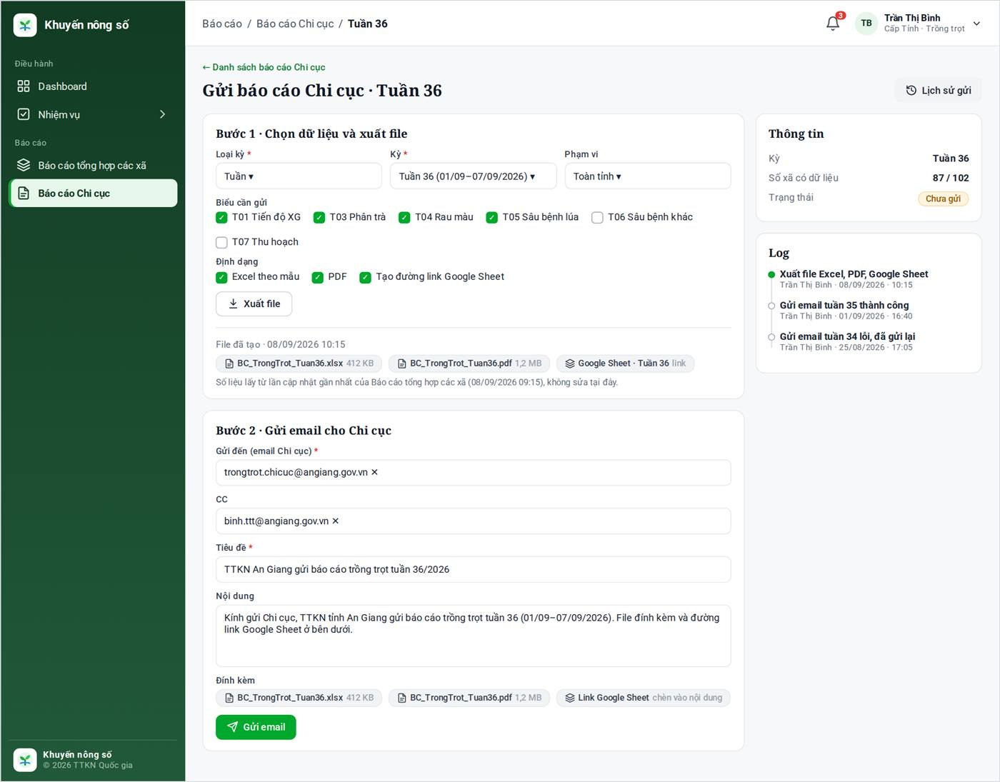

#### FN-TI-02.07 — Lịch công tác (đăng ký và duyệt lịch Cấp Xã)
- **Mô tả:** xem, duyệt hoặc yêu cầu chỉnh sửa lịch tuần của Cán bộ xã thuộc Phòng ban mình; biết ai chưa đăng ký; cán bộ tỉnh đăng ký lịch của mình. **Menu:** Điều hành › Nhiệm vụ › Lịch công tác (có số đếm).
- **Luồng:** tab “Chờ duyệt”, chọn tuần, lọc xã, trạng thái → chọn lịch → “Duyệt” hoặc “Yêu cầu chỉnh sửa” (**bắt buộc lý do**) → tab “Lịch của tôi”: đăng ký lịch tuần → “Gửi đăng ký”.
- **Phụ:** duyệt hàng loạt; xuất Excel/PDF; tab “Chưa đăng ký”; lịch chờ duyệt quá hạn → nhắc người duyệt.
- **Quy tắc:** chỉ Cấp Tỉnh cùng Phòng ban, cùng tỉnh mới xem, duyệt; **lịch tuần đã kết thúc bị khóa**; mọi lần duyệt lưu lịch sử. **Người duyệt là Trưởng phòng Trồng trọt**; thời hạn đăng ký và thời hạn duyệt do TTKN tỉnh cấu hình.
- **AC:** lịch Cán bộ xã gửi hiện ngay ở “Chờ duyệt”; không xem được lịch Phòng ban/tỉnh khác; AC-CHUNG.
- **Thiết kế:** tab Chờ duyệt / Đã duyệt / Chưa đăng ký / Lịch của tôi; lưới tuần (dòng = Cán bộ xã kèm xã phụ trách, cột = 7 ngày; thẻ mục công tác, mục trùng giờ tô vàng); nút Duyệt lịch đã chọn, Yêu cầu chỉnh sửa, Duyệt hàng loạt, Xuất Excel/PDF.

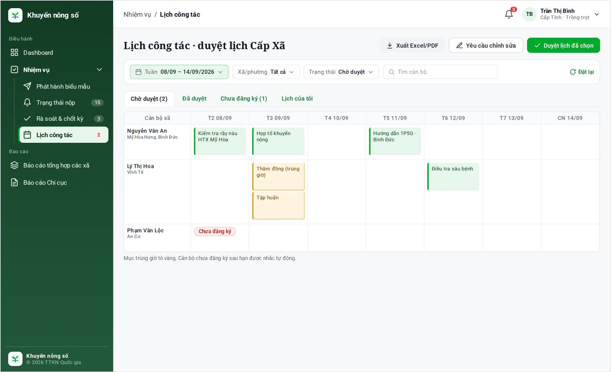

**[PT]** “Trưởng phòng” không phải vai trò riêng; trên màn tài khoản (Hình 25b) có trường **“Cấp quản lý”** (vd Chuyên viên) của từng vai trò → người duyệt = Cấp Tỉnh có cấp quản lý “Trưởng phòng” (cần khách xác nhận danh sách giá trị, Q-05).

### 4.4 Cấp Xã

#### FN-XA-03.01 — Công việc cần làm
- **Mô tả:** danh sách công việc nộp báo cáo của các xã được phân công (sinh từ 02.02), kèm nhắc nhở và yêu cầu điều chỉnh từ Cấp Tỉnh; điểm vào chính để mở biểu. **Menu:** Điều hành › Nhiệm vụ › Công việc cần làm (số đếm việc cần xử lý) — **trang mặc định của Cấp Xã**.
- **Luồng:** liệt kê công việc mọi xã phụ trách (xã, biểu, kỳ, hạn, trạng thái) → lọc xã, loại kỳ, trạng thái, biểu, mặc định sắp theo hạn gần nhất → “Nhập” mở biểu đúng tab xã và kỳ.
- **Phụ:** **thông báo đẩy trên Mobile** khi có công việc mới, sắp đến hạn, nhắc nhở; không có → “Chưa có công việc”; quá hạn → nhãn “Trễ hạn”, **vẫn nộp được đến khi chốt kỳ**.
- **Quy tắc:** trạng thái do hệ thống cập nhật: **Chưa nhập, Lưu nháp, Đã nộp, Trễ hạn, Yêu cầu điều chỉnh, Đã chốt** (+ “Đã xác nhận” từ 02.04); chỉ thấy công việc của xã và Phòng ban được gán.
- **AC:** công việc mới hiện ngay sau phát hành; trạng thái chuyển “Đã nộp” ngay sau khi gửi; AC-CHUNG.
- **Thiết kế (Hình 3f/13):** bộ lọc Xã/phường (mặc định tất cả xã phụ trách), Loại kỳ, Trạng thái, Biểu; nhãn đếm Cần làm / Trễ hạn / Yêu cầu điều chỉnh; khung nhắc mới nhất của Cấp Tỉnh; bảng STT, Xã, Báo cáo (kèm lý do yêu cầu điều chỉnh), Kỳ, Hạn nộp, Trạng thái, Cập nhật, nút **Nhập / Tiếp tục / Sửa / Xem**.

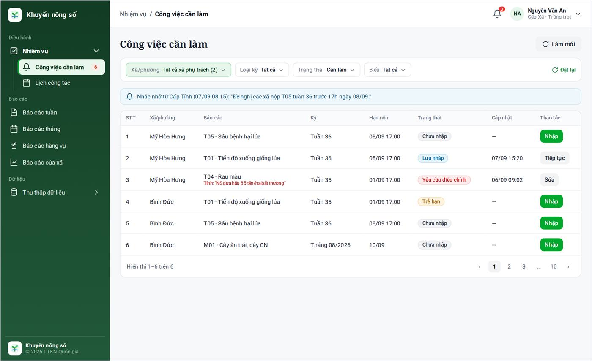

#### FN-XA-03.02 — Nhập báo cáo theo biểu mẫu
- **Mô tả:** nhập số liệu gốc theo 14 mẫu (UR-XA-02…15). **Màn hình giữ đúng sheet Excel**: cùng cột, tiêu đề gộp, công thức, dòng “Yêu cầu biểu mẫu”; **không thêm trường**. Chỉ hiện dòng của xã được phân công; **mỗi xã một tab**. **Menu:** Báo cáo › Báo cáo tuần (T01–T07) / tháng (M01) / hàng vụ (V01–V06), hoặc từ Công việc cần làm. Admin nhập thay khi hỗ trợ.
- **Tiên quyết:** biểu đã phát hành cho xã; tài khoản đã gán xã phụ trách.
- **Luồng:** mở biểu, kỳ → chọn tab xã → nhập ô nhập; **với mẫu đặt nhiều kỳ trên một dòng (PL 01, PL 01B, PL 02, PL 07) chỉ cột/khối của kỳ đang mở được nhập** → “Lưu nháp” hoặc “Gửi báo cáo” → trước chốt kỳ được sửa và gửi lại.
- **Phụ:** “Tải mẫu Excel” (đúng file mẫu, chỉ dòng của xã), “Nhập từ Excel”; **nhập offline trên Mobile, tự đồng bộ; tự lưu nháp khi chuyển tab**. Vi phạm yêu cầu của mẫu (vd tổng các trà ≠ số đã xuống giống) → báo tại ô, **không cho gửi**. Gửi sau chốt kỳ → từ chối.
- **Quy tắc:** chỉ Cán bộ xã Phòng Trồng trọt nhập cho xã được phân công; cột STT, Khu vực, Xã và cột Tỉnh giao cố định; **cột công thức tính đúng công thức mẫu, không sửa tay**; mỗi lần gửi lưu lịch sử (người, thời điểm, giá trị cũ – mới); sau chốt kỳ khóa; chỉ “Đã gửi” tính vào tổng hợp; Cấp Tỉnh không nhập đè; **không áp dụng quy tắc kiểm tra ngoài yêu cầu của mẫu**.
- **AC:** bố cục bảng trùng sheet mẫu (**đối chiếu theo chữ cái cột**); Cán bộ xã không thấy dòng xã khác; số liệu gửi hiện ngay trên tổng hợp Cấp Tỉnh (**[PT]** nghĩa là hiện trong “Thay đổi chờ cập nhật”/thông báo “Có n thay đổi”, bảng chính chỉ đổi sau “Cập nhật” theo FN-TI-02.05); AC-CHUNG.
- **Thiết kế:** đầu trang mã + tên biểu, vụ, kỳ (chuyển kỳ trước/sau), hạn nộp, tên sheet mẫu (vd “PL 01_Tđộ XG TĐ 2026”); nút Nhập từ Excel, Tải mẫu Excel, Lịch sử sửa, Lưu nháp, Gửi báo cáo; tab xã có nhãn trạng thái; khung “Yêu cầu biểu mẫu” nguyên văn; bảng dựng từ mẫu: hàng chữ cái cột, tiêu đề gộp, một dòng của xã. **Màu ô:** xám = cố định; trắng viền = ô nhập; viền xanh đậm = cột kỳ đang nhập; xám nhạt = kỳ khác chỉ xem; xanh lá nhạt = công thức. **Biểu > 20 cột: cố định cột định danh (vd A–J), cuộn ngang, ô “Đi tới” nhóm cột.**

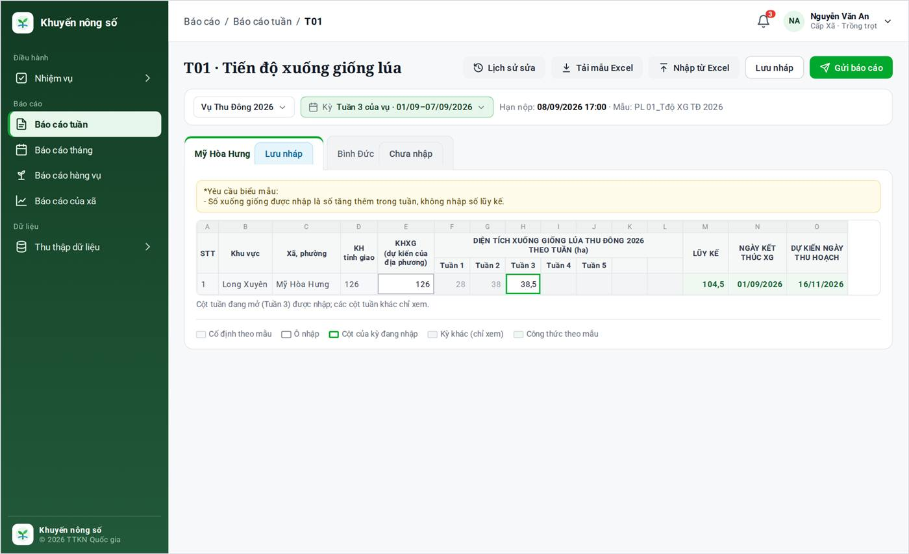
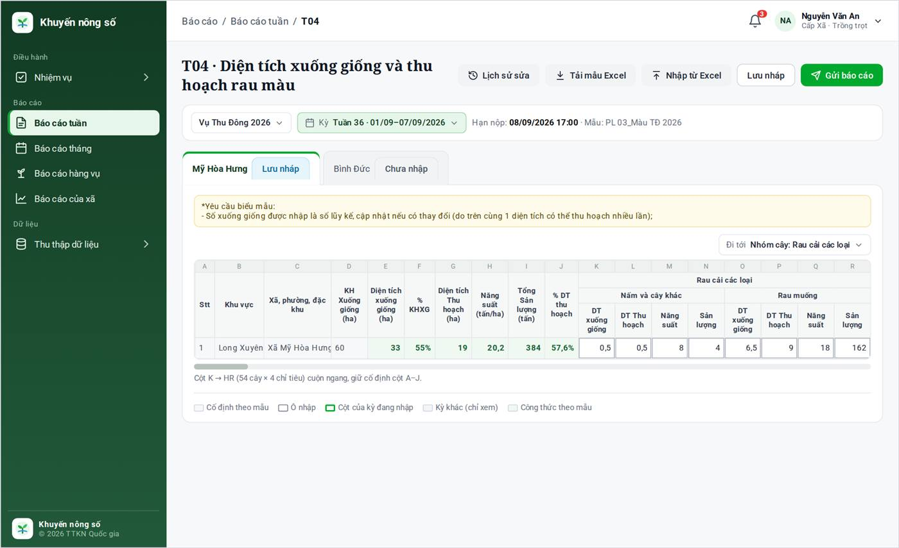

**Bảng FN-XA-02 — 14 mẫu báo cáo:**

| Mã | Tên | Sheet mẫu | Kỳ | Cách nhập theo mẫu | UR |
|---|---|---|---|---|---|
| T01 | Tiến độ xuống giống lúa | PL 01 (bộ tuần) | Tuần | Số tăng thêm, cột tuần trên cùng dòng | UR-XA-02 |
| T02 | Xuống giống, phân trà lúa mùa | PL 01B (bộ tuần) | Tuần, xã có lúa mùa | Số tăng thêm; bảng phụ phân trà | UR-XA-03 |
| T03 | Phân trà lúa | PL 02 (bộ tuần) | Tuần | Tổng các trà = số đã xuống giống ở PL 01 | UR-XA-04 |
| T04 | Xuống giống, thu hoạch rau màu | PL 03 (bộ tuần) | Tuần | Số lũy kế; 54 cây × 4 cột | UR-XA-05 |
| T05 | Sâu bệnh hại lúa | PL 04 (sheet theo tuần) | Tuần, bắt buộc | 20 đối tượng × 3 mức | UR-XA-06 |
| T06 | Sâu bệnh hại cây trồng khác | PL 05 (sheet theo tuần) | Tuần, bắt buộc | 70 cặp cây – sâu bệnh × 3 mức | UR-XA-07 |
| T07 | Tiến độ thu hoạch lúa | PL 07 (bộ tuần) | Tuần, giai đoạn thu hoạch | Số tăng thêm, khối 4 cột mỗi tuần | UR-XA-08 |
| M01 | Cây ăn trái, cây công nghiệp | Sheet tháng (bộ tháng) | Tháng, trước ngày 10 | 30 cây × 6 cột; hiện có tự tính | UR-XA-09 |
| V01 | Áp dụng 3 giảm 3 tăng | PL1 (bộ vụ) | Vụ | Theo cột mẫu | UR-XA-10 |
| V02 | Áp dụng 1 phải 5 giảm | PL2 (bộ vụ) | Vụ | Theo cột mẫu | UR-XA-11 |
| V03 | Trang thiết bị cơ giới hóa | PL3 CGH (bộ vụ) | Vụ | 14 loại máy; diện tích áp dụng | UR-XA-12 |
| V04 | Cơ cấu giống lúa | PL4 CCG (bộ vụ) | Vụ | 40 giống; DTXG = tổng các giống | UR-XA-13 |
| V05 | Lượng giống gieo sạ | PL5 (bộ vụ) | Vụ | 4 nhóm lượng giống | UR-XA-14 |
| V06 | Diện tích tham gia mô hình | PL6 (bộ vụ) | Vụ | Theo cột mẫu | UR-XA-15 |

Quy tắc khởi tạo 14 mẫu (từ FN-AD-04.06): M01 dùng sheet **“Tháng 7”** và **sửa công thức lệch cột**; PL 01 tiêu đề cột tuần theo kỳ phát hành (số cột = số kỳ); PL 02 giữ cột cùng kỳ **M–O** do Cán bộ xã nhập, tiêu đề ngày theo kỳ phát hành; PL 07 **thêm công thức cho khối “Lũy kế thu hoạch”**; PL1 3G3T cột “Mật độ sạ ≤ 150 kg/ha” là ô nhập số thực tế; PL2 1P5G dùng **khối cột A–P đầu tiên**; nhóm lượng giống V05: **≤ 80; trên 80 – dưới 100; 100–150; trên 150 kg/ha**; “Phiếu thống kê công cụ, thiết bị 4 lĩnh vực” **không** đưa vào module. Cấu trúc đã biết chi tiết hơn ở §8.

#### FN-XA-03.03 — Quản lý HTX & nông hộ
- **Mô tả:** danh sách HTX (tên, người đại diện, SĐT, diện tích, trạng thái) và nông hộ thành viên (mã hộ, chủ hộ, diện tích) trên các xã phụ trách. **Người dùng:** Cấp Xã (thêm, sửa), Cấp Tỉnh, Cấp Quốc gia (xem), Admin (nạp ban đầu). **Menu:** Dữ liệu › Thu thập dữ liệu › Danh sách HTX. **Tiên quyết:** ĐVHC đã thiết lập.
- **Luồng:** chọn xã, tìm, lọc → thêm / sửa / vô hiệu hóa HTX → mở HTX, tab “Nông hộ” thêm, sửa → Xuất Excel. **Phụ:** nạp Excel hàng loạt (chỉ nạp dòng hợp lệ); vô hiệu hóa HTX có thửa, máy → cảnh báo.
- **Quy tắc:** chỉ trong xã phụ trách; **vô hiệu hóa thay xóa cứng**; **SĐT là dữ liệu cá nhân, hiển thị che một phần**.
- **AC:** không thao tác ngoài phạm vi; không xóa được HTX đã có dữ liệu liên kết; AC-CHUNG.
- **Thiết kế:** List (lọc Xã, Trạng thái, Diện tích, tìm, Đặt lại; cột STT, tên HTX, người đại diện, SĐT che, diện tích, số nông hộ, trạng thái, xem/sửa/xóa; Nạp Excel, Xuất Excel, Thêm HTX). Detail HTX: Sửa, Thêm nông hộ, Vô hiệu hóa; khối Thông tin chung, Địa bàn – sản xuất; tab Nông hộ / Máy móc / Thửa ruộng; Log.

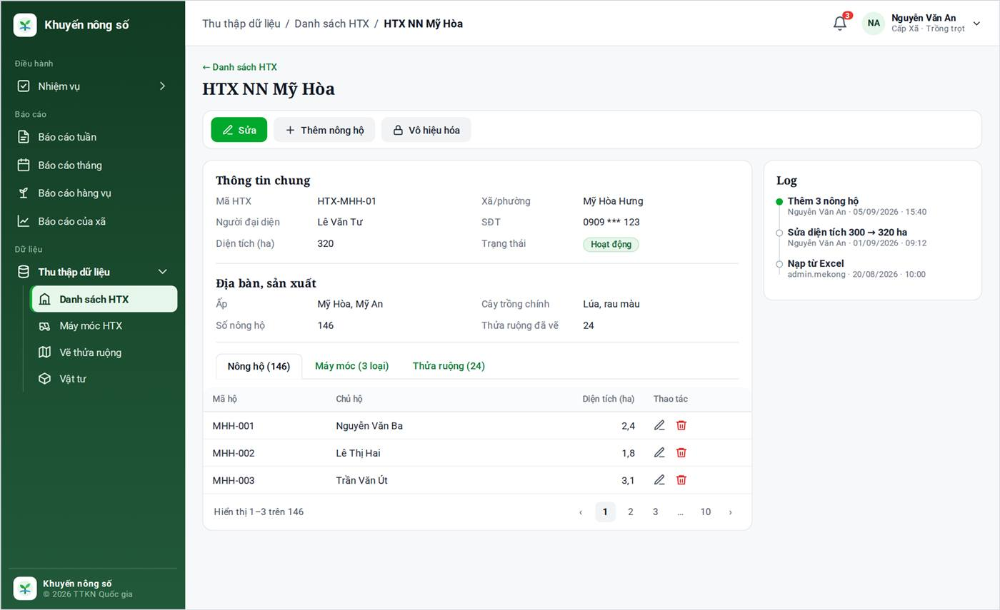

#### FN-XA-03.04 — Quản lý máy móc của HTX
- Khai báo loại máy cơ giới và số lượng của từng HTX; xem tổng theo xã. Cấp Xã (thêm, sửa), Tỉnh, QG (xem). Menu: Dữ liệu › Thu thập dữ liệu › Máy móc HTX. Tiên quyết: HTX có; danh mục loại máy có.
- Luồng: chọn HTX → thêm/sửa/xóa dòng (loại máy, số lượng, ghi chú) → Lưu → xem tổng theo loại của xã. Phụ: nạp Excel; số lượng âm/không nguyên → chặn; trùng loại trong HTX → gợi ý cập nhật dòng đã có.
- Quy tắc: loại máy từ danh mục; lưu lịch sử thay đổi số lượng. AC: tổng theo loại của xã = tổng các HTX; AC-CHUNG.
- Thiết kế: trái danh sách HTX + tổng xã theo loại máy; phải bảng nhập (loại máy, số lượng, ghi chú, ngày cập nhật, xóa dòng, Thêm dòng), Lưu, Nạp Excel.

#### FN-XA-03.05 — Vẽ ranh giới thửa ruộng
- Khoanh vẽ thửa của nông hộ/HTX trên bản đồ vệ tinh; tự khép vùng, tự tính diện tích, so với diện tích khai báo. Cấp Xã; Admin. Menu: Dữ liệu › Thu thập dữ liệu › Vẽ thửa ruộng. Tiên quyết: tài khoản đã gán xã; **Mobile đã tải bản đồ nền offline**.
- Luồng: mở bản đồ xã phụ trách và danh sách thửa → “Vẽ lô mới”: chọn HTX, nhập **tên nông dân**, tên lô, ghi chú → vẽ bằng **chấm điểm, hình tròn hoặc hình vuông**, tối thiểu 3 điểm → khép vùng, tính diện tích; đối chiếu khai báo → “Lưu ranh giới”.
- Phụ: tải KML/Shapefile/GeoJSON; < 3 điểm → chặn; chồng lấn → cảnh báo, hiển thị phần chồng lấn; mất mạng → lưu tạm, tự đồng bộ.
- Quy tắc: diện tích luôn tự tính, không nhập tay đè; chỉ vẽ trong địa bàn phân công. AC: **không lưu được ranh giới không khép kín hoặc chồng lấn**; vẽ offline đồng bộ đủ 100%; AC-CHUNG.

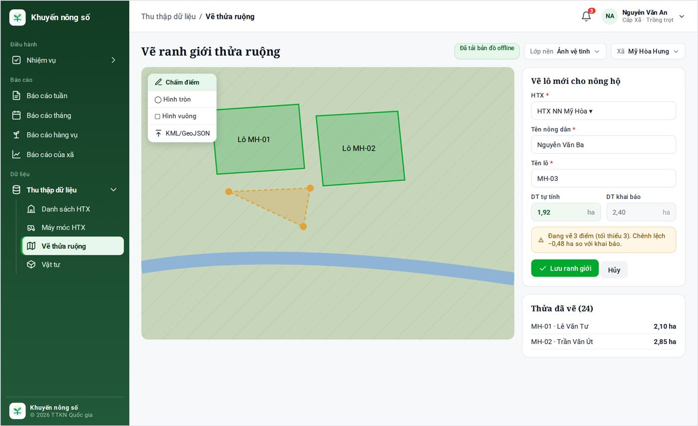

#### FN-XA-03.06 — Nhập thông tin vật tư
- Ghi nhận vật tư nông nghiệp trên xã theo danh mục Vật tư: loại, số lượng/khối lượng, đơn vị tính, thời điểm ghi nhận. Cấp Xã (thêm, sửa); Cấp Tỉnh (xem). Menu: Dữ liệu › Thu thập dữ liệu › Vật tư.
- Luồng: chọn xã, thời điểm → thêm dòng (loại vật tư, số lượng, ĐVT theo danh mục, ghi chú) → Lưu → xem lịch sử ghi nhận. Phụ: nạp Excel; giá trị không hợp lệ theo ĐVT → chặn. Quy tắc: loại từ danh mục. AC: **Cấp Tỉnh xem được tổng hợp vật tư theo xã**; AC-CHUNG.

#### FN-XA-03.07 — Báo cáo của xã
- Xem lại báo cáo đã gửi và thống kê từng xã phụ trách; xuất đúng mẫu. Menu: Báo cáo › Báo cáo của xã.
- Luồng: tab xã, loại kỳ, vụ, biểu → danh sách (biểu, kỳ, trạng thái, gửi lúc, chốt kỳ) → “Xem” chỉ đọc; “Sửa” nếu chưa chốt; “Xuất Excel”. Phụ: đã chốt chỉ xem. Quy tắc: chỉ xã phân công. AC: thống kê khớp báo cáo đã gửi; AC-CHUNG.
- Thiết kế: khung “Thống kê của xã” theo vụ: DT xuống giống / KH, DT nhiễm sâu bệnh, số báo cáo nộp đúng hạn.

#### FN-XA-03.08 — Lịch công tác (đăng ký hằng tuần)
- Đăng ký lịch tuần (nội dung, thời gian, địa điểm, thành phần phối hợp), gửi Cấp Tỉnh duyệt. Menu: Điều hành › Nhiệm vụ › Lịch công tác. Tiên quyết: đã gán Phòng ban và xã phụ trách.
- Luồng: chọn tuần (**mặc định tuần kế tiếp**) → thêm mục theo ngày, buổi/giờ: nội dung, địa điểm (xã, HTX), thành phần phối hợp, ghi chú → “Gửi duyệt” → “Chờ duyệt” → nhận kết quả; nếu “Yêu cầu chỉnh sửa” thì sửa, gửi lại.
- Phụ: sao chép tuần trước; **điều chỉnh lịch đã duyệt → phần điều chỉnh chờ duyệt lại**; trùng thời gian → cảnh báo; quá hạn đăng ký → nhãn “Đăng ký muộn”.
- Quy tắc: **bắt buộc đăng ký hằng tuần**; trạng thái **Nháp → Chờ duyệt → Đã duyệt / Yêu cầu chỉnh sửa**; lịch tuần đã kết thúc bị khóa. AC: Cán bộ xã nhận thông báo kết quả duyệt kèm lý do; AC-CHUNG.
- Thiết kế: lưới tuần dòng Sáng/Chiều × 7 ngày; khung “Mục công tác”; trạng thái + hạn đăng ký; Sao chép tuần trước, Gửi duyệt.

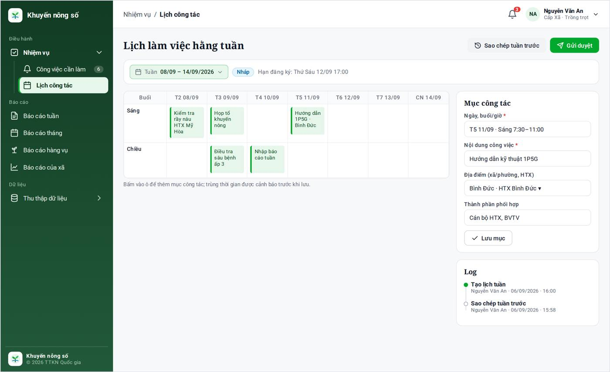

### 4.5 Admin (trình tự khởi tạo: ĐVHC → cơ cấu tổ chức → phòng ban → tài khoản → danh mục → mẫu báo cáo)

#### FN-AD-04.01 — Danh mục đơn vị hành chính
- Nạp, duy trì ĐVHC chuẩn (**Tỉnh → Xã/Phường/Đặc khu**, sắp xếp 2025). Menu: Quản trị hệ thống › Đơn vị hành chính.
- Luồng: nạp (mã, tên, cấp, loại, mã cấp trên, ngày hiệu lực) → bổ sung tọa độ trung tâm và ranh giới (GeoJSON/Shapefile) → sắp xếp ĐVHC: khai báo ĐVHC mới, chọn ĐVHC cũ hợp nhất; lưu ánh xạ mã, ĐVHC cũ “Hết hiệu lực”.
- Phụ: xuất, tra lịch sử; dòng lỗi chỉ nạp dòng hợp lệ; vô hiệu hóa ĐVHC đang liên kết khi chưa có ánh xạ → chặn.
- Quy tắc: mã duy nhất, không tái sử dụng; không xóa, chỉ “Hết hiệu lực”. AC: đúng tỉnh An Giang và các xã/phường; không chọn được ĐVHC ngoài danh mục; AC-CHUNG.

#### FN-AD-04.02 — Cơ cấu tổ chức 3 cấp
- Cây **TTKNQG → TTKN tỉnh → Xã/phường**, liên kết ĐVHC; gán **Khu vực** cho Nút xã. Cây là căn cứ phạm vi dữ liệu mọi tài khoản. Menu: Quản trị hệ thống › Cơ cấu tổ chức 3 cấp.
- Luồng: thêm Nút (Nút cha, tên, mã, cấp, mã ĐVHC, Khu vực với Nút xã) → sửa → **di chuyển Nút xã sang Nút tỉnh khác** (bảng ảnh hưởng → lý do → xác nhận) → vô hiệu hóa khi sáp nhập/giải thể.
- Phụ: nạp/xuất Excel; lịch sử; Nút cha không hợp lệ → chặn; xóa Nút có con/tài khoản/dữ liệu → chặn, gợi ý vô hiệu hóa; di chuyển Nút có kỳ chưa chốt → cảnh báo.
- Quy tắc: **xem xuống, không xem ngang, không xem lên**; **không di chuyển Nút cấp 1, cấp 2**; **số liệu đã chốt giữ theo cấu trúc tại thời điểm chốt**; mọi thay đổi lưu vết.
- AC: cây trực quan; di chuyển Nút cập nhật ngay phạm vi tài khoản; báo cáo nhóm đúng theo Khu vực; AC-CHUNG.
- Thiết kế: cây (TTKNQG › TTKN tỉnh › **Khu vực** › Xã) — Khu vực hiển thị như nhóm trong cây nhưng là thuộc tính; form Nút (tên, mã vd “AG-MHH”, cấp, Nút cha, mã ĐVHC, Khu vực); bảng Ảnh hưởng (tài khoản, HTX, thửa ruộng, kỳ chưa chốt); Log.

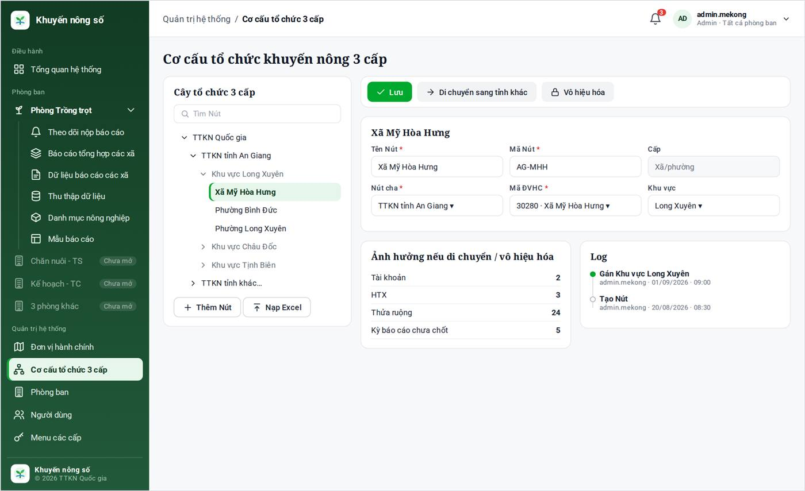

#### FN-AD-04.03 — Danh mục phòng ban
- Khai báo Phòng ban (module) **cho từng đơn vị** và trạng thái áp dụng; điều khiển bước 2 đăng nhập và chiều phân quyền theo Phòng ban. **TTKN An Giang khai báo 6 Phòng ban, Phòng Trồng trọt “Đang áp dụng”.** Menu: Quản trị hệ thống › Phòng ban. Tiên quyết: Nút cấp 1, 2 đã có.
- Luồng: chọn đơn vị → danh sách (mã, tên, trạng thái, thứ tự, số tài khoản) → thêm/sửa (mã, tên, mô tả, thứ tự) → đổi trạng thái **Đang áp dụng / Chưa mở / Ngưng hoạt động**.
- Phụ: xem tài khoản thuộc phòng ban; trùng mã trong đơn vị → chặn; ngưng phòng ban có tài khoản/dữ liệu → cảnh báo, dữ liệu cũ giữ nguyên.
- Quy tắc: chỉ “Đang áp dụng” chọn được khi đăng nhập; không xóa phòng ban đã có tài khoản/dữ liệu. AC: chuyển “Đang áp dụng” hiện ngay ở bước 2 đăng nhập; AC-CHUNG.
- **[PT]** Wireframe cho thấy 6 phòng ban: Trồng trọt; Chăn nuôi - Thủy sản; Kế hoạch - Tài chính; Thông tin - Truyền thông; + 2 phòng khác (tên chưa có → Q-02).

#### FN-AD-04.04 — Tài khoản và phân quyền
- Tạo, cập nhật, khóa/mở khóa, đặt lại mật khẩu, phân quyền. **Một tài khoản nhiều vai trò, nhiều phòng ban; mỗi vai trò có phạm vi riêng: Nút, phòng ban (một hoặc nhiều), cấp quản lý, xã/phường phụ trách (Cấp Xã).** Menu: Quản trị hệ thống › Người dùng. Tiên quyết: ĐVHC, cơ cấu tổ chức, phòng ban.
- Luồng: List (lọc vai trò, Nút, phòng ban, trạng thái; tìm họ tên, email) → “Tạo tài khoản” hoặc xem/sửa → **màn Detail** → sửa Thông tin tài khoản (họ tên, email, SĐT); khối “Vai trò và phạm vi”: thêm, sửa, xóa vai trò → “Lưu thay đổi” → lưu DB + **một dòng Log chỉnh sửa**; tài khoản mới: **tạo mật khẩu tạm và gửi kích hoạt** → “Gửi lại mật khẩu”, “Khóa tài khoản” / “Mở khóa”, đều ghi log.
- Phụ: nạp Excel; thao tác hàng loạt; trùng tên đăng nhập/SĐT/email → từ chối; Cấp Xã chưa gán xã → cho lưu, cảnh báo, chưa xem được dữ liệu nghiệp vụ; gửi kích hoạt lỗi → gửi lại.
- Quy tắc: chỉ Admin quản lý tài khoản; nút “Tạo tài khoản” khóa khi chưa có Nút và phòng ban; mỗi vai trò gắn 1 Nút; phạm vi = Nút và cấp dưới, lọc theo phòng ban của vai trò; mỗi phiên 1 vai trò + 1 phòng ban (Admin toàn hệ thống); Cấp Xã chỉ trên xã được gán, mỗi xã một tab khi nhập; **khóa tài khoản thu hồi ngay mọi phiên**; xóa vai trò không xóa dữ liệu đã nhập bằng vai trò đó.
- AC: tài khoản mới đúng phạm vi; vai trò khác Admin không thấy menu “Người dùng”; **hai Cán bộ xã khác Phòng ban trên cùng xã chỉ thấy dữ liệu Phòng ban mình**; mọi lần lưu, khóa, gửi lại mật khẩu, thêm/xóa vai trò hiện trong Log với người, thời điểm, giá trị cũ → mới; AC-CHUNG.
- Thiết kế Detail: “← Danh sách tài khoản”, tiêu đề họ tên; nút Lưu thay đổi, Hủy, Gửi lại mật khẩu, Khóa tài khoản; khối Thông tin tài khoản (họ tên*, trạng thái, email*, SĐT); bảng Vai trò và phạm vi (vai trò, Nút, phòng ban, cấp quản lý, xã phụ trách, sửa/xóa), “Thêm vai trò”; tab Thông tin hệ thống (tạo bởi/lúc, sửa gần nhất bởi/lúc, đăng nhập gần nhất · kênh Web/Mobile, kích hoạt), Phiên đang hoạt động, Lịch sử đăng nhập; cột phải Log chỉnh sửa + “Xem toàn bộ log”.

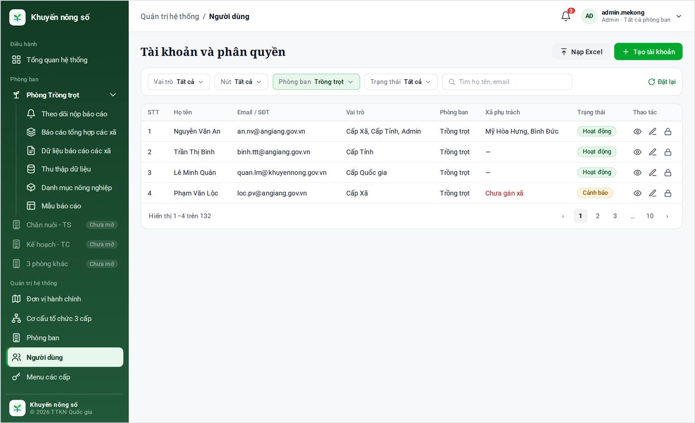
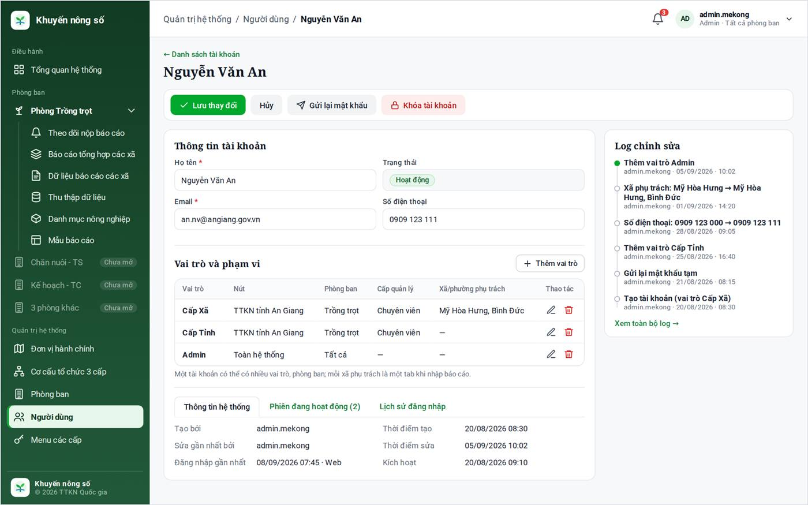

#### FN-AD-04.05 — Danh mục nông nghiệp
- Tạo, sửa, vô hiệu hóa: **Giống lúa, Vật tư, Cây trồng, Sâu bệnh dịch hại (gắn cây trồng bị ảnh hưởng), Loại máy móc, Mô hình sản xuất**. Menu: **Phòng ban › Phòng Trồng trọt › Danh mục nông nghiệp** (Admin).
- Luồng: chọn tab → danh sách (mã, tên, nhóm, ĐVT, **biểu đang dùng**, trạng thái) → thêm/sửa/vô hiệu hóa. Phụ: nạp/xuất Excel; trùng mã/tên → chặn; vô hiệu hóa mục có số liệu → cho phép, số cũ giữ nguyên.
- Quy tắc: danh mục chuẩn; vai trò khác chỉ chọn; không xóa cứng mục đã dùng; **ngưỡng mức độ nhiễm sâu bệnh không bắt buộc, điền sau**; **loại máy dùng 14 loại theo PL3 CGH**. AC: mục mới hiện ngay trong biểu và màn nhập; AC-CHUNG.
- Thiết kế: 6 tab kèm số mục; nhóm phân cấp (vd Cây ăn quả › Xoài); mục vô hiệu hóa hiện mờ.

#### FN-AD-04.06 — Quản lý mẫu báo cáo
- **Mô tả:** Admin chỉnh mẫu báo cáo của các phòng ban cấp tỉnh và cấp xã: thêm, bớt cột; thêm, bớt dòng (dòng tiêu đề, dòng chỉ tiêu); gộp, tách ô; đặt công thức; tạo mẫu mới (trống, nhân bản, nạp từ Excel) và gán vào loại báo cáo của phòng ban. Menu: Phòng ban › <Phòng ban> › Mẫu báo cáo.
- **Luồng:** B1 chọn phòng ban, cấp (Tỉnh/Xã), loại báo cáo, mẫu; hoặc “Tạo mẫu mới”. B2 chỉnh trên lưới: + cột trước/sau, xóa cột, + dòng tiêu đề, + dòng chỉ tiêu, xóa dòng, gộp/tách ô, công thức. B3 thuộc tính cột: tiêu đề, **loại cột (Cố định / Tỉnh giao / Nhập / Cột theo kỳ / Công thức)**, kiểu dữ liệu, đơn vị, bắt buộc, danh mục chọn. B4 thuộc tính mẫu: tên, mã, phòng ban, loại báo cáo, cấp nhập liệu, **áp dụng từ kỳ**. B5 “Xem trước màn hình nhập liệu” → “Lưu nháp” hoặc **“Phát hành phiên bản”**. B6 gán mẫu vào loại báo cáo.
- **Phụ:** lịch sử phiên bản; khôi phục phiên bản cũ thành nháp; **sửa mẫu đã có số liệu → chỉ tạo phiên bản mới, áp dụng từ kỳ sau**; xóa cột/dòng đã có số ở phiên bản trước → cho phép ở phiên bản mới, số cũ giữ theo phiên bản cũ; công thức tham chiếu ô không tồn tại → lỗi, không lưu; mẫu chưa gán loại → không phát hành được.
- **Quy tắc:** chỉ Admin sửa/tạo mẫu; Cấp Tỉnh chỉ chọn mẫu đã gán cho phòng ban mình; **mỗi mẫu có phiên bản; kỳ đã có số liệu giữ phiên bản cũ**; mẫu thuộc đúng một phòng ban và một cấp nhập liệu; một loại báo cáo gồm nhiều mẫu; quy tắc khởi tạo 14 mẫu (đã nêu ở 03.02); **loại “Báo cáo đột xuất”**: Admin tạo mẫu và gán loại này khi có yêu cầu; menu “Báo cáo đột xuất” (có số đếm) chỉ hiện trong nhóm Báo cáo của Cấp Xã, Cấp Tỉnh khi phòng ban đã có mẫu loại này.
- **AC:** thêm/bớt cột, dòng hiện đúng trên màn nhập và bảng tổng hợp từ kỳ áp dụng; mẫu mới gán cho phòng ban hiện trong danh sách phát hành của Cấp Tỉnh phòng ban đó; AC-CHUNG.
- **Thiết kế:** lọc Phòng ban, Cấp, Loại báo cáo, Mẫu; “Lịch sử phiên bản”, “Tạo mẫu mới”; khung Chỉnh sửa cấu trúc (thanh công cụ, lưới đúng Excel với hàng chữ cái, **dòng cuối hiển thị loại cột**: Cố định, Tỉnh giao, Nhập, Kỳ, ƒx); bảng Gán mẫu (phòng ban, cấp, loại báo cáo, mẫu, phiên bản, trạng thái — vd Xã/Báo cáo tuần/T01–T07/v1/Đang áp dụng; **Tỉnh/Báo cáo gửi Chi cục/CC01 (mẫu mới)/Nháp**); cột phải Thuộc tính mẫu (tên, mã, phiên bản “v2 (nháp)”, phòng ban, loại báo cáo, cấp nhập liệu, áp dụng từ kỳ “Tuần 37/2026”) và Thuộc tính cột (tiêu đề, loại cột, kiểu dữ liệu, đơn vị, bắt buộc).

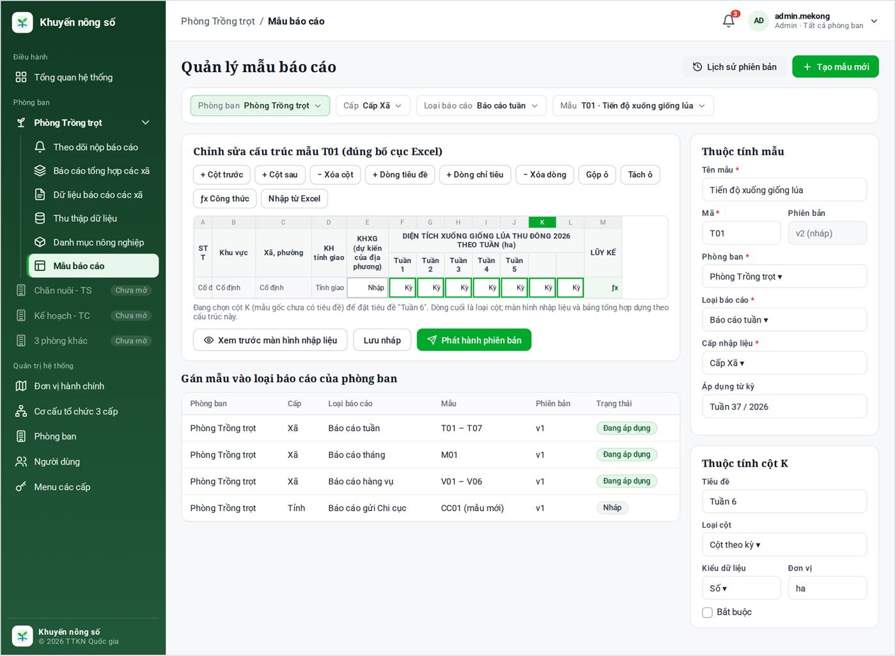

**[PT]** Hình 27 có loại báo cáo cấp Tỉnh “Báo cáo gửi Chi cục” với mẫu CC01 → báo cáo Chi cục có thể là một mẫu riêng (không chỉ là bản xuất của T01–T07). Cần khách xác nhận (Q-08).

#### FN-AD-04.07 — Menu các cấp (hỗ trợ người dùng)
- Admin truy cập menu Cấp Quốc gia, Tỉnh, Xã để hỗ trợ; nhập liệu thay Cấp Xã khi cần; mọi thao tác trên dữ liệu nghiệp vụ ghi nhật ký riêng. Menu: Quản trị hệ thống › Menu các cấp. **Tiên quyết: tài khoản Admin xác thực nhiều yếu tố.**
- Luồng: chọn vai trò và tài khoản/xã cần hỗ trợ → “Vào menu” → menu vai trò đó với **dải cảnh báo vàng đang hỗ trợ** → thao tác; **khi lưu, nhập lý do** → xem nhật ký. Phụ: thoát chế độ hỗ trợ.
- Quy tắc: nhật ký lưu thời điểm, Admin, thay cho ai, chức năng, nội dung thay đổi, lý do; **không xóa nhật ký**. AC: mọi thao tác hỗ trợ có trong nhật ký; AC-CHUNG.

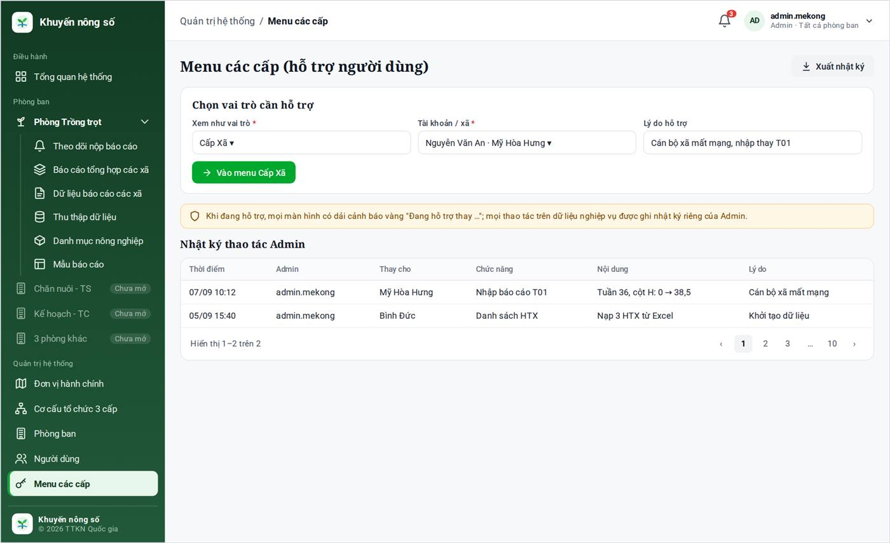

---

## 5. Phân quyền

### 5.1 Nguyên tắc
- RBAC 4 vai trò: Admin, Cấp Quốc gia, Cấp Tỉnh, Cấp Xã. Một tài khoản nhiều vai trò và phòng ban; **mỗi phiên 1 vai trò + 1 phòng ban**, đổi trong menu tài khoản. Admin không chọn phòng ban.
- **Phạm vi dữ liệu = Nút (xem xuống, không ngang, không lên) ∩ Phòng ban của phiên; Cấp Xã thêm điều kiện xã/phường được phân công.**
- Module chỉ chứa dữ liệu, menu, báo cáo Phòng Trồng trọt.
- Cấp Quốc gia chỉ xem. Cấp Tỉnh thiết lập, phát hành, theo dõi, rà soát, chốt kỳ, lập báo cáo; **không nhập đè** số gốc của Xã. Cấp Xã nhập số gốc.
- Admin truy cập toàn bộ menu các cấp; mọi thao tác của Admin trên dữ liệu nghiệp vụ được lưu vết.

### 5.2 Ma trận (C tạo, R xem, U sửa, D xóa/vô hiệu hóa, — không quyền)

| Mã | Chức năng | Admin | Quốc gia | Tỉnh | Xã |
|---|---|---|---|---|---|
| FN-CH-00.01 | Đăng nhập & chọn phòng ban | R | R | R | R |
| FN-TW-01.01 | Dashboard (TW) | R | R | — | — |
| FN-TW-01.02 | Báo cáo của Tỉnh và Xã (TW) | R | R | — | — |
| FN-TI-02.01 | Dashboard toàn tỉnh | R | — | R | — |
| FN-TI-02.02 | Phát hành biểu mẫu | R | — | CRUD | R (cột Tỉnh giao) |
| FN-TI-02.03 | Trạng thái nộp, nhắc nhở | R | — | CRU | — |
| FN-TI-02.04 | Rà soát, yêu cầu điều chỉnh, chốt kỳ | R | — | CRU | — |
| FN-TI-02.05 | Báo cáo tổng hợp các xã | R | — | R + Cập nhật | — |
| FN-TI-02.06 | Xuất file, gửi email Chi cục | R | — | CRU + Gửi email | — |
| FN-TI-02.07 | Lịch công tác (duyệt) | R | — | CRU lịch mình; R + Duyệt lịch Xã | — |
| FN-XA-03.01 | Công việc cần làm | R | — | — | R |
| FN-XA-03.02 | Nhập báo cáo theo biểu | CRU (nhập thay) | — | R (qua 02.04) | CRU (đến chốt kỳ, xã phân công) |
| FN-XA-03.03 | HTX & nông hộ | CRUD | R | R | CRU (trong xã) |
| FN-XA-03.04 | Máy móc HTX | CRUD | R | R | CRUD (trong xã) |
| FN-XA-03.05 | Vẽ thửa ruộng | CRUD | R | R | CRUD (trong xã) |
| FN-XA-03.06 | Vật tư | CRUD | — | R | CRU (trong xã) |
| FN-XA-03.07 | Báo cáo của xã | R | — | — | R |
| FN-XA-03.08 | Lịch công tác (đăng ký) | R | — | — | CRU lịch mình, gửi duyệt |
| FN-AD-04.01 | Danh mục ĐVHC | CRUD | R | R | R |
| FN-AD-04.02 | Cơ cấu tổ chức 3 cấp | CRUD | R | R | R |
| FN-AD-04.03 | Danh mục phòng ban | CRUD | — | — | — |
| FN-AD-04.04 | Tài khoản và phân quyền | CRUD | — | — | — |
| FN-AD-04.05 | Danh mục nông nghiệp | CRUD | R | R | R |
| FN-AD-04.06 | Quản lý mẫu báo cáo | CRUD | — | R (chọn mẫu khi phát hành) | — |
| FN-AD-04.07 | Menu các cấp | CRU | — | — | — |

**[PT]** Mâu thuẫn nhỏ: ma trận ghi Cấp Quốc gia R với HTX/máy/thửa nhưng menu Cấp Quốc gia (Hình 3d) không có nhóm Dữ liệu → hiểu là quyền xem qua drill-down (Q-06).

---

## 6. Menu theo vai trò (dựng lại từ Hình 3c–3f và đường dẫn FN)

| Vai trò | Điều hành | Báo cáo | Dữ liệu | Trang mặc định |
|---|---|---|---|---|
| **Cấp Quốc gia** | Dashboard | Báo cáo tuần · Báo cáo tháng · Báo cáo hàng vụ · Báo cáo năm | — | Dashboard |
| **Cấp Tỉnh** | Dashboard; **Nhiệm vụ** › Phát hành biểu mẫu · Trạng thái nộp (đếm) · Rà soát & chốt kỳ (đếm) · Lịch công tác (đếm) | Báo cáo tổng hợp các xã · Báo cáo Chi cục · (Báo cáo đột xuất – khi có mẫu) | — | Dashboard |
| **Cấp Xã** | **Nhiệm vụ** › Công việc cần làm (đếm) · Lịch công tác | Báo cáo tuần · Báo cáo tháng · Báo cáo hàng vụ · Báo cáo của xã · (Báo cáo đột xuất – khi có mẫu) | **Thu thập dữ liệu** › Danh sách HTX · Máy móc HTX · Vẽ thửa ruộng · Vật tư | Công việc cần làm |
| **Admin** | Tổng quan hệ thống | nhóm **Phòng ban**: mỗi phòng ban (Trồng trọt mở; Chăn nuôi - TS, Kế hoạch - TC, 3 phòng khác “Chưa mở”) › Theo dõi nộp báo cáo · Báo cáo tổng hợp các xã · Dữ liệu báo cáo các xã · Thu thập dữ liệu · Danh mục nông nghiệp · Mẫu báo cáo | nhóm **Quản trị hệ thống**: Đơn vị hành chính · Cơ cấu tổ chức 3 cấp · Phòng ban · Người dùng · Menu các cấp | Tổng quan hệ thống |

Menu tài khoản (mọi vai trò): “Đang dùng: <Vai trò · Phòng ban>”; “Đổi vai trò / phòng ban” (liệt kê các cặp khác; nếu chỉ có 1 thì ghi “Tài khoản chỉ có 1 vai trò, 1 phòng ban”); Đổi mật khẩu; Đăng xuất. Cấp Xã **không có Dashboard** (chốt v7.4).

---

## 7. Yêu cầu phi chức năng

| Loại | Tiêu chí |
|---|---|
| Hiệu năng | Thao tác thường < 3 giây trên 3G; **Dashboard và bản đồ < 5 giây với 500 người dùng đồng thời** |
| Bảo mật | ATTT cấp độ 3; mã hóa truyền và lưu; **MFA cho Admin**; phân quyền; **nhật ký truy cập ≥ 1 năm** |
| Mở rộng | Mở thêm Phòng ban bằng cấu hình danh mục + mẫu báo cáo; mở rộng từ An Giang sang tỉnh khác |
| Offline | Nhập báo cáo (03.02) và vẽ thửa (03.05) trên Mobile khi mất mạng; lưu tạm, tự đồng bộ, không mất, không trùng |
| Tương thích Excel | Nhập/xuất đúng file mẫu hiện hành; **công thức tính trên hệ thống, kết quả trùng Excel** |
| Tích hợp | Xuất Excel/PDF/**Word**; gửi email bằng **email công vụ TTKN An Giang (SMTP)**; tạo Google Sheet và chia sẻ link qua **tài khoản Google của TTKN An Giang (Drive/Sheets API)**; App HTX và hệ thống Chi cục ngoài phạm vi |
| Tuân thủ | NĐ 13/2023/NĐ-CP; NĐ 85/2016/NĐ-CP; TT 60/2025/TT-BNNMT |
| Truy vết | Mọi bản ghi có người tạo, người sửa, thời điểm tạo, sửa, **phiên bản**; thay đổi quan trọng có log cũ → mới; **số liệu đã chốt không xóa, chỉ điều chỉnh có lý do**; thao tác Admin ghi riêng |
| Sẵn sàng, sao lưu | **≥ 99,5%/tháng** (trừ bảo trì báo trước); **sao lưu DB hằng ngày, giữ ≥ 30 ngày; RPO ≤ 24 giờ; RTO ≤ 4 giờ** |
| Mobile | Android giá rẻ, mạng 3G (UR-KT-01); PIN 6 số, offline 72 giờ, phiên 24 giờ (FN-CH-00.01) |

---

## 8. Cấu trúc mẫu báo cáo đã biết (từ văn bản và wireframe)

### 8.1 Loại cột (dùng cho engine mẫu)
`Cố định` (STT, Khu vực, Xã — hệ thống điền), `Tỉnh giao` (Cấp Tỉnh nhập khi phát hành, Xã chỉ xem), `Nhập` (Cán bộ xã nhập), `Cột theo kỳ` (số cột = số kỳ đã chia; chỉ cột của kỳ đang mở được nhập), `Công thức` (tính theo mẫu, không sửa tay). Thuộc tính cột: tiêu đề, kiểu dữ liệu (Số…), đơn vị (ha, tấn, t/ha, %…), bắt buộc, danh mục chọn. Mỗi bảng có hàng chữ cái cột Excel, dòng tiêu đề gộp nhiều tầng, khung “Yêu cầu biểu mẫu” nguyên văn.

### 8.2 Chi tiết từng mẫu
| Mã | Đã biết | Nguồn |
|---|---|---|
| **T01** (PL 01) | A STT · B Khu vực · C Xã, phường · D **KH tỉnh giao** (Tỉnh giao) · E **KHXG (dự kiến của địa phương)** (Nhập) · F…L “DIỆN TÍCH XUỐNG GIỐNG LÚA <VỤ> THEO TUẦN (ha)” Tuần 1…n (Cột theo kỳ, số tăng thêm) · M **LŨY KẾ** (công thức = tổng tuần) · N **NGÀY KẾT THÚC XG** · O **DỰ KIẾN NGÀY THU HOẠCH**. Yêu cầu biểu mẫu: “Số xuống giống được nhập là số tăng thêm trong tuần, không nhập số lũy kế”. Sheet tên dạng “PL 01_Tđộ XG TĐ 2026” | Hình 14, 10, 5, 27 |
| **T02** (PL 01B) | Số tăng thêm; bảng phụ phân trà; chỉ xã có lúa mùa | Bảng FN-XA-02 |
| **T03** (PL 02) | Tổng các trà = số đã xuống giống ở PL 01 (ràng buộc liên biểu); cột cùng kỳ **M–O** do Cán bộ xã nhập; tiêu đề ngày theo kỳ phát hành; nhiều kỳ trên một dòng | FN-XA-02, FN-AD-04.06 |
| **T04** (PL 03) | A Stt · B Khu vực · C Xã, phường, đặc khu · D KH Xuống giống (ha) · E Diện tích xuống giống (ha) · F % KHXG · G DT thu hoạch (ha) · H Năng suất (tấn/ha) · I Tổng sản lượng (tấn) · J % DT thu hoạch (E–J là tổng/công thức) · từ K: **54 cây × 4 chỉ tiêu** (DT xuống giống, DT thu hoạch, Năng suất, Sản lượng) tới cột **HR**, tiêu đề gộp 2 tầng nhóm cây (vd “Rau cải các loại” › “Nấm và cây khác”, “Rau muống”…). Số **lũy kế**. Yêu cầu: “Số xuống giống được nhập là số lũy kế, cập nhật nếu có thay đổi (do trên cùng 1 diện tích có thể thu hoạch nhiều lần)”. Cố định A–J, cuộn ngang, “Đi tới nhóm cây” | Hình 15 |
| **T05** (PL 04) | 20 đối tượng sâu bệnh × 3 mức; tuần, bắt buộc | FN-XA-02 |
| **T06** (PL 05) | 70 cặp cây – sâu bệnh × 3 mức; tuần, bắt buộc | FN-XA-02 |
| **T07** (PL 07) | Số tăng thêm; khối 4 cột mỗi tuần; thêm công thức khối “Lũy kế thu hoạch” | FN-XA-02, FN-AD-04.06 |
| **M01** | 30 cây × 6 cột; có cột tự tính; sheet “Tháng 7”, sửa công thức lệch cột; nộp trước ngày 10 | FN-XA-02, FN-AD-04.06 |
| **V01** (PL1 3G3T) | “Theo cột mẫu”; cột “Mật độ sạ ≤ 150 kg/ha” là ô nhập số thực tế | FN-AD-04.06 |
| **V02** (PL2 1P5G) | “Theo cột mẫu”; dùng khối cột A–P đầu tiên | FN-AD-04.06 |
| **V03** (PL3 CGH) | 14 loại máy (= danh mục loại máy); diện tích áp dụng | FN-XA-02, FN-AD-04.05 |
| **V04** (PL4 CCG) | 40 giống; DTXG = tổng các giống | FN-XA-02 |
| **V05** (PL5) | 4 nhóm: ≤ 80; > 80 – < 100; 100–150; > 150 kg/ha | FN-AD-04.06 |
| **V06** (PL6) | “Theo cột mẫu” | FN-XA-02 |

### 8.3 Phải xin TTKN An Giang
Danh sách cột/dòng đầy đủ, công thức, “Yêu cầu biểu mẫu” nguyên văn và file Excel gốc của **cả 14 mẫu** — đặc biệt T02, T03, T05, T06, T07, M01, V01–V06 chưa có một cột nào cụ thể; T04 chưa có danh sách 54 cây và 4 chỉ tiêu cho từng cây; T05 danh sách 20 đối tượng và 3 mức; T06 danh sách 70 cặp; M01 30 cây và 6 cột; V03 14 loại máy; V04 40 giống. Chi tiết ở kn-v7.7-plan.md §4.

---

## 9. Các quyết định đã chốt (v7.4–v7.6, không còn điểm mở)
1. Một tài khoản có nhiều vai trò, phòng ban; màn “Chọn vai trò và phòng ban”; **bỏ ô chọn vai trò ở màn đăng nhập**.
2. Admin không chọn phòng ban; menu Admin gom dữ liệu theo phòng ban; có trang Tổng quan hệ thống.
3. **Cấp Xã không có Dashboard.**
4. Báo cáo Chi cục **chỉ xuất file và gửi email** cho Chi cục từ hệ thống (kèm file hoặc link Google Sheet); không có bước trình duyệt.
5. AC-CHUNG cho mọi FN (lưu DB + truy vết).
6. Màn Detail tài khoản có Log chỉnh sửa (người, thời điểm, cũ → mới).
7. **Báo cáo đột xuất** do Admin tạo mẫu và gán loại khi cần; menu chỉ hiện khi phòng ban có mẫu loại này.
8. Tên sản phẩm, logo, ảnh nền, footer theo nhận diện TTKNQG.
9. Sẵn sàng ≥ 99,5%, sao lưu hằng ngày giữ 30 ngày, RPO 24 giờ, RTO 4 giờ.
10. Dùng **email công vụ và tài khoản Google của TTKN An Giang** để gửi báo cáo Chi cục.
11. (v7.1) Bỏ chức năng riêng “Thiết lập vụ, lịch kỳ” và “Kế hoạch tỉnh giao, số liệu nền”: kỳ, hạn nộp, Tỉnh giao khai báo khi phát hành biểu.
12. (v7.1) Báo cáo tổng hợp các xã chỉ cập nhật khi bấm “Cập nhật” và một lần tự động lúc chốt kỳ.

## 10. Danh mục hình đã trích
Ảnh JPG (rộng tối đa 1400 px) trong [kn-v7.7-img/](kn-v7.7-img/): h02 To-Be; h03a–h03f đăng nhập và menu; h05 TW báo cáo; h07 phát hành; h08 trạng thái nộp; h09 rà soát; h10 tổng hợp; h11 Chi cục; h12 duyệt lịch; h13 công việc; h14 T01; h15 T04; h16b chi tiết HTX; h18 vẽ thửa; h21 đăng ký lịch; h23 cơ cấu tổ chức; h25a/b tài khoản; h27 mẫu báo cáo; h28 menu các cấp. Các hình còn lại (Hình 1, 4, 6, 16a, 17, 19, 20, 22, 24, 26) nằm trong docx gốc; nội dung đã mô tả bằng chữ ở trên.
